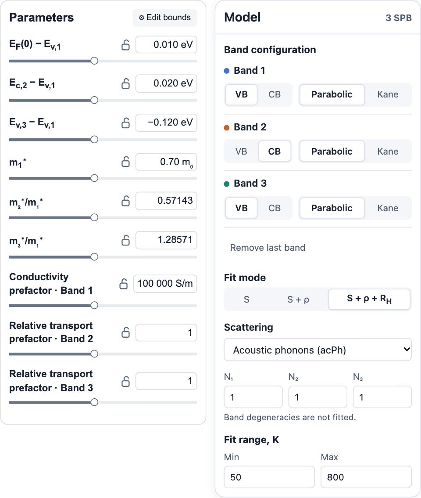
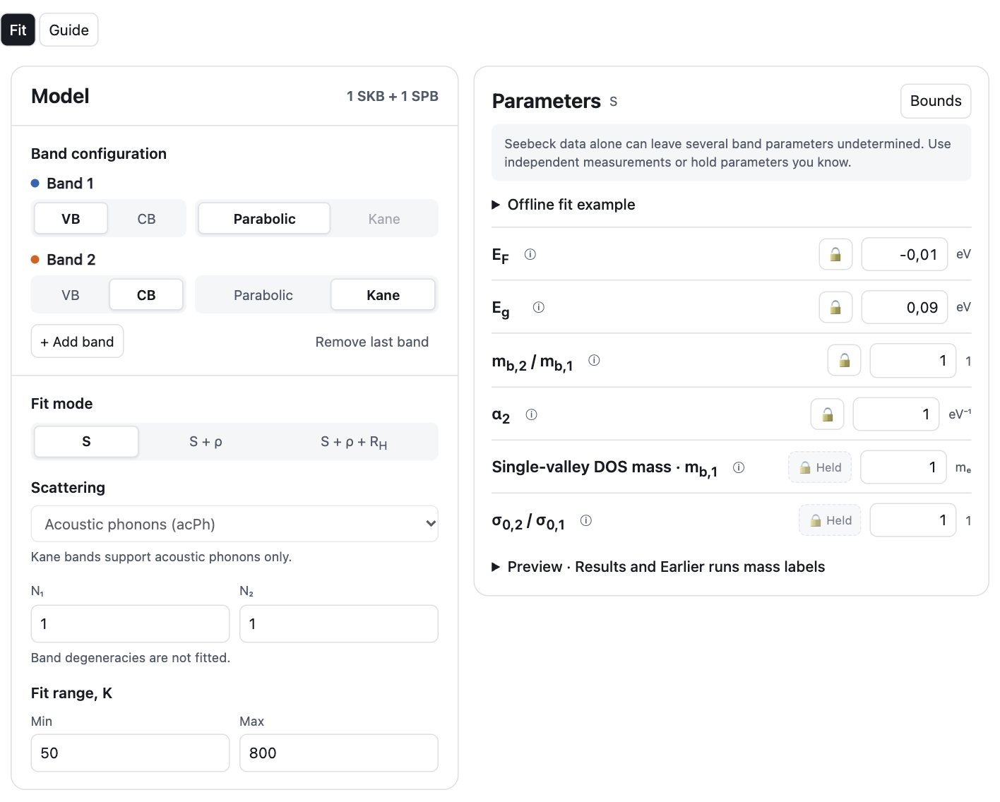
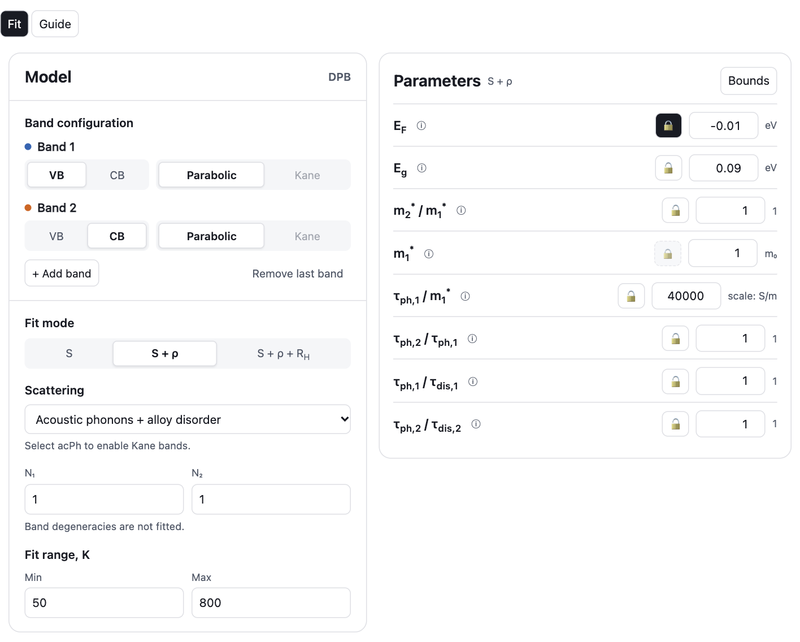
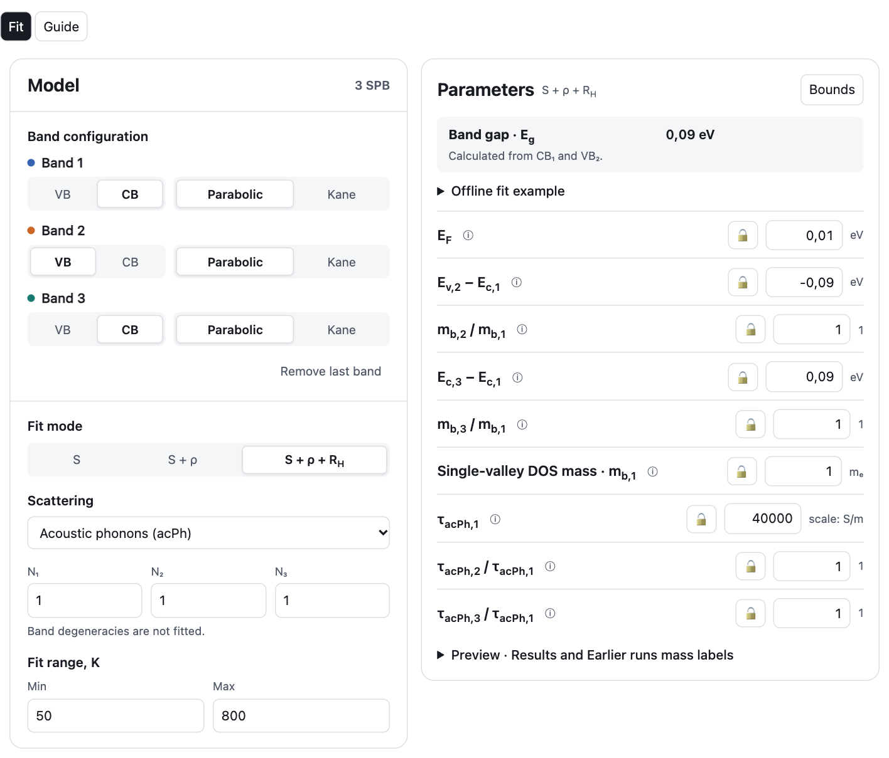
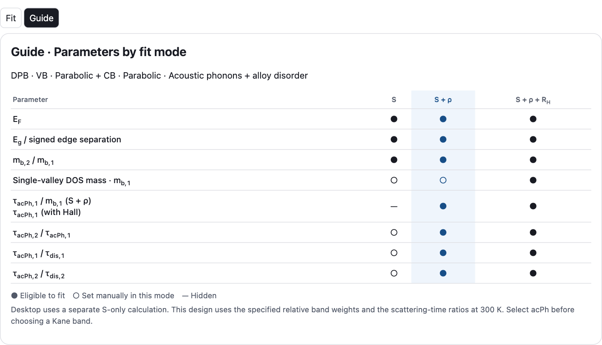

# Band Models in SeeBand Web

**Technical design for review · 21 November 2026 · revision 0.7**

**Design status.** This proposal uses `main` at `e9b0fa3` as its repository baseline. The explicit two-band parabolic core tested at P18 revision `8e4f98d` is absent from that baseline and from this PR. The band builder, three-band transport and acoustic Kane integration are proposed extensions. Sections 7 and 10–14 describe the numerical checks. The [review guide](band-composition-v0.7/REVIEW.md) identifies which results readers can reproduce from this branch.

**Interface decision · 21 November 2026.** For three bands, the agreed interface has a persistent **Band gap · E_g** row at the top of Parameters. It displays the energy gap of the selected bands and identifies the edges that determine it. The fit uses two independent offsets relative to the first band. Behavior when the determining band changes, when bands overlap, and when data are incomplete is specified in §15.1. This is an interface decision; approval of the transport core is considered separately in §§7–8.

## 1 What the researcher will see

In the existing **Model** card, the researcher defines the composition row by row. The name is computed automatically. In **Parameters**, they enter values, hold parameters, and set fit bounds. Fit mode, Scattering, Nᵢ, and the temperature range remain in Model. The new composition has no separate p/n selector.

One band gives SPB or SKB, two give DPB or 1 SKB + 1 SPB, and three give 3 SPB or 1 SKB + 2 SPB. For an all-parabolic composition, acPh, dis, ionized, and acPh + dis are available. When Kane is selected, only one mechanism remains available: acPh.


**Layout A. Full Fit screen.** Data and the four existing plot slots are on the left. Fit actions are at the upper right, followed by Parameters and Model, then Result. The example has no measurements and no completed fit. The colored lines show direct calculations for the specified parameters. The layout reproduces FitPage from P18. Labels and sliders in the illustration are schematic.

### 1.1 What carries over from the current Fit screen


**Reference screen.** The screenshot from the project guide shows the panel arrangement for DPB. Its values and result belong to the guide demonstration. In branch P18, selection of a two-band configuration and p/n has already been added to the Model card. In P18 these controls were implemented by `ExplicitDpbControls`.

On a wide screen, FitPage gives the right column 600 px when the viewport is at least 1200 px wide. Within that column, Parameters is to the left of Model. Below 1200 px, Data and plots come before Fit and its settings. The two cards stack when there is not enough room for two 294 px columns and a gap. Each card has its own heading. On a narrow screen, the order is Fit, Parameters, Model, Result. [Current layout](../../../apps/web/src/pages/FitPage.tsx).

### 1.2 What changes inside Model and Parameters



**Layout B. State shown in the photograph.** Read Band configuration from top to bottom: Band 1 — VB / Parabolic, Band 2 — CB / Parabolic, Band 3 — VB / Parabolic. The heading at right computes 3 SPB. The three-band limit has been reached, so Remove last band is available. Below are Fit mode, Scattering, N₁/N₂/N₃, and Fit range. Each band keeps its number when the edges cross in energy.

The adjacent Parameters card shows E_F, two edge offsets, m₁, two mass ratios, and the amplitudes for the selected mode. The common reference E₁ = 0 is fixed. The starting value is edited with a field and slider; the lock icon controls whether it is held; the button in the heading opens the existing bounds editor. Values used for the illustration are E₂ − E₁ = 0.020 eV, E₃ − E₁ = −0.120 eV, E_F = 0.010 eV, m₁ = 0.70 mₑ, m₂ = 0.40 mₑ, m₃ = 0.90 mₑ, A = 100 000 S/m, and B₂ = B₃ = N₁ = N₂ = N₃ = 1. The plots in Layout A were generated in the acoustic limit by the script in Section 14 at 50–800 K. A and B are formula keys in this calculation. Public labels are defined in §15. Slider positions in the illustration are illustrative. The researcher sets individual bounds.

### 1.3 Moving from DPB to a mixed model



**Layout C. Two bands, one Kane.** Starting from Layout B, click Remove last band. The heading becomes DPB, and the Band 3 row, N₃, and third-band parameters disappear. Select Kane for Band 2. The heading changes to 1 SKB + 1 SPB. A nonparabolicity parameter for Band 2 appears in Parameters. Band 1 fields and their selected bounds are preserved. Kane is disabled for Band 1. Fit mode still selects the set of observables, while Scattering allows only acPh.

If dis, ionized, or acPh + dis was selected before choosing Kane, the layout asks the researcher to select acPh first. Changing the mechanism automatically would conceal a scientifically important decision. To move Kane to another band, the researcher first returns the current band to Parabolic. Add band creates a final row with parabolic dispersion; removal is unavailable when there is only one band. Selecting a mechanism or composition does not itself start the optimizer.

### 1.4 Where to change the project

| P18 area                                                           | Change and verification criterion                                                                                                                                                                                                                                                                                       |
| ------------------------------------------------------------------ | ----------------------------------------------------------------------------------------------------------------------------------------------------------------------------------------------------------------------------------------------------------------------------------------------------------------------- |
| FitPage, FitPanel, DataBar, ResultPanel                            | Preserve the current layout, measurement loading, buttons, and result. Check wide and narrow screens. A completed result stores the composition used to obtain it.                                                                                                                                                      |
| ModelPanel → ModelControls, ExplicitDpbControls, selection.ts      | Replace manual SPB/DPB, the old VB+CB list, and p/n with band rows for the new contract. Use the existing button groups and shared Model fields. Build N fields from the list length; the server description defines supported modes and mechanisms. The DPB or 3 SPB label is for display.                             |
| store.ts, ParametersPanel, parameters.ts, BoundsEditor             | Parameters, bounds, and holds are currently addressed by mode.id and parameter name. Extend identification with stable band IDs. Changing Band 2 updates the applicable fields in one state transition. Preserve compatible values, holds, and Band 1 bounds. Remove active fields for a deleted band from the request. |
| liveCurves.ts → calcRequest, fitRequest.ts → fitRequest, ChartGrid | For the new composition, both builders read the same snapshot of bands, valley multiplicities, settings, and parameters. The prediction path updates the existing slots. E(k) gets one curve per band and one E_F line. Fit uses the existing button. A late response must not replace a plot for newer state.          |
| models.py, calc.py, band_diagram.py, fit.py, sessionFile.ts        | Add a data variant and route to the physics core within the existing APIs. Existing descriptions and methods remain necessary to read older sessions. New formulas require core approval under Section 8. The first end-to-end example reproduces SPB/DPB; new compositions are connected afterward.                    |

**End-to-end scenario to check.** Load measurements, select DPB, and set custom bounds and a hold for Band 1. Add a third band, change mode from S to S + ρ + Hall, and compare the preserved fields. Remove the third band, make Band 2 a Kane band, and check Scattering availability. After Run fit, compare the result with a repeated calc using the final vector. Save and reopen the session; compare types, IDs, multiplicities, bounds, and curves. For an old session, preserve its original result and explicitly request missing parameters as described in Section 6. The test is end-to-end only after it has run in the application against a real API.

**Code review entry points.** [ModelPanel](../../../apps/web/src/model/ModelPanel.tsx), [model and mode selection](../../../apps/web/src/model/selection.ts), [session state](../../../apps/web/src/session/store.ts), [ParametersPanel](../../../apps/web/src/model/ParametersPanel.tsx), [bounds editor](../../../apps/web/src/model/BoundsEditor.tsx), [curve request](../../../apps/web/src/model/liveCurves.ts), [fit request](../../../apps/web/src/model/fitRequest.ts), [four plot panels](../../../apps/web/src/model/ChartGrid.tsx).

## 2 Sample parameters and observables

| Input                    | Meaning and behavior                                                                                                                                                                                                                                                                       |
| ------------------------ | ------------------------------------------------------------------------------------------------------------------------------------------------------------------------------------------------------------------------------------------------------------------------------------------ |
| Type, dispersion, and Nᵢ | Set by the researcher. Nᵢ counts equivalent valleys. The spin factor 2 is included in the density of states exactly once. The fit determines neither the multiplicity nor the number of bands.                                                                                             |
| E₁ = 0, Eᵢ − E₁          | E₁ fixes the reference. Two bands have one independent edge energy; three have two. Either sign of offset is allowed. A band keeps its number if the edge ordering changes.                                                                                                                |
| E_F                      | Common zero-temperature Fermi energy relative to edge 1 (E₁ = 0). On screen it has no (0) suffix; finite-temperature chemical potential is denoted μ(T). It can be specified, held, or fitted within researcher-defined bounds. A value inside the gap is allowed for a mixed composition. |
| m₁, Mᵢ = mᵢ/m₁           | Positive isotropic single-valley masses at the edge; absolute masses are in units of mₑ. In S and S + ρ, the researcher sets the absolute scale. When Hall is included, m₁ may be fitted if the measurements are sensitive to the scale.                                                   |
| αᵢ and normalizations    | A Kane band may have a nonparabolicity parameter in eV⁻¹. Its public form must be agreed with the SKB model. Conductivity and scattering parameters appear according to the implemented core description.                                                                                  |
| Results                  | S in V/K, ρ in Ω·m, R_H in m³/C, n and p in m⁻³. The diagram shows dispersions and one E_F line. The temperature-dependent μ(T) curve is displayed separately.                                                                                                                             |

For a pair of the same type, show the edge separation |Eⱼ − Eᵢ|. For a mixed set, calculate d = min(E_CB) − max(E_VB). For d > 0, show model gap d; for d < 0, show overlap |d|; at equality, show zero model gap. A material gap cannot be determined from CB-only or VB-only bands. These three labels add no fit degrees of freedom. Parameter αᵢ characterizes a particular dispersion. Tying αᵢ to the inverse direct gap requires independent justification, even if an observable offset between pockets is available.

A new band is created as parabolic. If a Kane band is already selected, Kane is unavailable in the other rows, with an indication of the occupied row. To move nonparabolicity, the researcher explicitly changes the old band to Parabolic and selects Kane for the new one. The quota applies to the declared type, including when α = 0. The server rejects a request with two Kane bands before calculation. Adding a band preserves other bands' values, bounds, and holds by their IDs. The new row gets its own multiplicity and parameter set. Default values are marked as starting assumptions. Switching Parabolic/Kane changes α availability only for that row. When composition changes, an active fit is cancelled or the change is blocked until it completes. A late response to an old request must not replace current curves. A parameter or structure change marks the previous result as belonging to the previous calculation.

## 3 From Fermi energy to carrier balance


**Figure 1.** The composition VB₁ + CB₂ + VB₃ is the same. On the left, the first two band edges coincide with E_F. On the right, CB₂ is 20 meV above VB₁ and E_F is 10 meV above VB₁. In both cases the third band is 120 meV below VB₁. Masses are illustrative. Coordinate q is measured from each band's own extremum. Aligning the vertices horizontally does not establish a direct material gap.

Consider independent three-dimensional isotropic valleys with hard edges. Let sᵢ = +1 for CB and −1 for VB, e > 0, and carrier charge qᵢ = −sᵢe. Kinetic energy u ≥ 0 is measured into the band; total electron energy is Eᵢ + sᵢu. In this and the next section, energies are in joules, mᵢ in kilograms, and αᵢ in J⁻¹. At the API boundary, energies with the `_k` suffix mean E/k_B. Convert α from eV⁻¹ to J⁻¹ by dividing its numerical value by the number of joules in one eV.

**Geometry.** Set γᵢ(u) = u(1 + αᵢu) = ℏ²k²/(2mᵢ). At αᵢ = 0 this is parabolic. For an unbounded branch, the proposed domain is αᵢ ≥ 0. A numerically stable inverse is u = 2x/(1 + √(1 + 4αᵢx)), where x = ℏ²k²/(2mᵢ). The diagram, density of states, and velocities must all use this same dispersion.

**Zero temperature.** For each trial fit vector, find u_Fi = max[sᵢ(E_F − Eᵢ), 0]. Filling a sphere in k-space gives Cᵢ(0) = Nᵢ k_Fi³/(3π²), where k_Fi = √(2mᵢγᵢ(u_Fi))/ℏ. The signed target excess D = Σᵢ sᵢ Cᵢ(0) has units m⁻³. D is constant within a single temperature calculation. It is recalculated when trial parameters change, including mass. The new mode does not require a separate input for concentration or its sign.

**Finite temperature.** The number of states per volume and energy is gᵢ(u) = [Nᵢ/(2π²)] · (2mᵢ/ℏ²)³ᐟ² √γᵢ(u) (1 + 2αᵢu). Define ζᵢ = sᵢ(μ − Eᵢ). Then Cᵢ(T, μ) = ∫ gᵢ(u) f(u − ζᵢ,T) du, integrating u from 0 to ∞. The core solves one equation, Σᵢ sᵢ Cᵢ(T, μ) = D. As μ rises, electron filling increases and hole filling decreases. The left side is strictly increasing for T > 0 and positive valley weights, so any existing finite root is unique.

**Limits of applicability.** A CB-only set requires D > 0; a VB-only set requires D < 0. At zero filling, such a single-polarity set has no finite root at T > 0. A mixed set allows either sign and D = 0. With a positive gap, all E_F positions in the closed interval give D = 0 and identical μ(T) and transport, all else equal. The fit cannot distinguish those positions even with ideal data. With band overlap, D = 0 can mean finite, equal electron and hole populations. The two opposite charges can then produce nonzero Hall response.

## 4 Scattering and transport

For independent pockets in a weak magnetic field, calculate scalar channel coefficients. Let Kᵣᵢ = ∫ [gᵢvᵢ²τᵢ/3] (u − ζᵢ)ʳ (−∂f/∂u) du. Then σᵢ = qᵢ²K₀ᵢ and Sᵢ = K₁ᵢ/(qᵢTK₀ᵢ). At T > 0 the thermal window broadens around μ(T). Every declared band contributes to the integral, including the lower VB in Figure 1. Pruning bands in advance based on whether they cross E_F gives a physically different result.

**Observable curves.** With σ = Σσᵢ and wᵢ = σᵢ/σ, ρ = 1/σ, S = ΣwᵢSᵢ, and R_H = Σwᵢ²R_Hᵢ. Electron and hole terms in Hall have opposite signs. Near exact compensation, the relative error of total Hall is poorly determined. For the electronic Lorenz number, the three-band generalization is L = ΣwᵢLᵢ + Σwᵢ(Sᵢ − S)². Calculate the total curve and band decomposition using one μ(T) and one set of weights.

For an isotropic Kane band, vᵢ² = 2γᵢ/[mᵢ(1 + 2αᵢu)²], and cyclotron mass m_cᵢ(u) = mᵢ(1 + 2αᵢu). In the scalar relaxation-time approximation, the signed numerator of weak-field Hall is Hᵢ = (qᵢ³/3)∫gᵢ vᵢ² τᵢ² (−∂f/∂u)/m_cᵢ du, R_Hᵢ = Hᵢ/σᵢ². The convention is R_H < 0 for an electron band. For a band with very small σᵢ it is preferable to sum through Hᵢ, avoiding division by a vanishing σᵢ². The scheme assumes independent pockets, isotropy, weak field, and intravalley scattering. A touching sketch does not establish the absence of hybridization, linear dispersion, or interband transitions.

| Model selection    | Contract for parabolic bands                                                                                                                                                                                                                            | Kane approval condition                                                                                                                 |
| ------------------ | ------------------------------------------------------------------------------------------------------------------------------------------------------------------------------------------------------------------------------------------------------- | --------------------------------------------------------------------------------------------------------------------------------------- |
| acPh + dis         | Proposed fourth choice for parabolic bands. See §14 for the 0.3.0 decision, restoration scope and multiband S-only contract.                                                                                                                            | Outside project scope for any composition containing Kane.                                                                              |
| Acoustic phonons   | Current law τ ∝ T⁻¹u⁻¹ᐟ². In P18, conductivity amplitude A and relative weight B.                                                                                                                                                                       | Lin–Liu acoustic model; formulas and numerical benchmark in Sections 12–13. Check implementation and interband weights before enabling. |
| Alloy disorder     | τ ∝ u⁻¹ᐟ². Normalization F and relative weight G; the core has the factor F·T.                                                                                                                                                                          | Outside project scope for any composition containing Kane.                                                                              |
| Ionized impurities | Adopted power law τ ∝ u³ᐟ², factor A·(T/300 K)³. SPB has no relative band weight. DPB uses the empirical prefactor in §11. Three-band weights await the decision in [#247](https://github.com/pdasya/seeband-web/issues/247) and a three-channel check. | Outside project scope for any composition containing Kane.                                                                              |

For three parabolic bands with one mechanism, extension of the current P18 normalization is proposed. With M₁ = b₁ = 1, the relative channel factor for band i is (Nᵢ/N₁)bᵢ/Mᵢ, Mᵢ = mᵢ/m₁. S-only inherits the convention bᵢ = 1; S + ρ and S + ρ + Hall introduce one bᵢ per additional band with one shared positive amplitude. This three-band parameterization requires physicist confirmation. For ionized impurities it is a candidate extension only. Keep three-band ionized calculations and fits unavailable until the weight law is agreed and checked as specified in §11. A zero transport amplitude for a band leaves its contribution to charge balance intact. Separate benchmarks are needed to reconcile amplitude dimensions in mixed Kane + parabolic models.

## 5 Interfaces and calculation state

**Contract for discussion.** A new discriminator `band_composition_v1` selects the calculation branch in the existing model registry. The client continues to call the existing HTTP endpoints. The server publishes a description of parameters and supported combinations. The same identifiers and units are used in /api/calc, /api/fit, and /api/band-diagram. The following is a fragment of the logical structure for Figure 1b. Specific names for new fields are proposed for discussion. E_F is present even for an intrinsic state; carrier_type is absent.

```json
{
  "parameterization": "band_composition_v1",
  "bands": [
    { "id": "b1", "type": "vb", "dispersion": "parabolic", "valleys": 1 },
    { "id": "b2", "type": "cb", "dispersion": "parabolic", "valleys": 1 },
    { "id": "b3", "type": "vb", "dispersion": "parabolic", "valleys": 1 }
  ],
  "reference_band_id": "b1",
  "fit_mode": "s_rho_hall",
  "scattering": "acPh",
  "parameters": {
    "fermi_energy_k": 116.045,
    "b2.edge_offset_k": 232.09,
    "b3.edge_offset_k": -1392.54,
    "b1.mass_me": 0.7,
    "b2.mass_ratio": 0.57143,
    "b3.mass_ratio": 1.28571
  }
}
```

The energies in the example are rounded. A complete request also adds the temperature range and active transport amplitudes from the mode description; a fit request passes measurements, start, held, and bounds. A public key for nonparabolicity could be, for example, `b2.alpha_per_ev`. An ID belongs to a band throughout its lifetime. Crossing edges does not reorder the array. A new band receives a free ID and a clean parameter set. Version one allows removal of the last band, leaving the reference band in place.

| Component           | Responsibility and verifiable output                                                                                                                                                                                                                                                |
| ------------------- | ----------------------------------------------------------------------------------------------------------------------------------------------------------------------------------------------------------------------------------------------------------------------------------- |
| seeband_core        | The registry checks composition and mechanism compatibility. From one immutable input it builds densities, μ(T), channel moments, total curves, statuses, and derived separations.                                                                                                  |
| FastAPI and OpenAPI | Distinguish old and new variants. Validate 1–3 bands, unique IDs, allowed fields, positive masses and multiplicities, and at most one declared Kane band. A 422 response contains an error code, field path, and reason. Kane + Kane is rejected for two-band compositions as well. |
| SeeBand Web         | Model selects structure, mode, mechanism, and T. Parameters builds numeric fields from metadata. Prediction requests are tied to a configuration snapshot. For a temporarily unsupported combination, show the reason and list available modes.                                     |
| Results and export  | The server returns T, calculated observable curves in SI, original band IDs, core version, laws, units, statuses, and warnings. CSV/ZIP and a repeated calc at the same snapshot agree with the plot and the final fit result.                                                      |

**Distinct outcomes.** Valid geometry may produce a band diagram even if the transport state is impossible. Zero filling in a single-polarity system reports a state error. Nonfinite quadrature or an unverified root reports a numerical error with T and the available residual. Poor fit quality is returned as a result with residuals. A network failure has a separate message. Transport availability is determined for the requested set of outputs, so Hall failure does not block an already verified S calculation.

## 6 Fit and compatibility

**Optimization domain.** Free parameters receive finite bounds and a starting point inside them from the researcher. The physical domain additionally requires positive masses, positive total conductivity, and an admissible balance. Slider constraints for manually changing one coordinate do not narrow the rectangular joint-fit domain. Paths through D = 0 and sign changes are allowed for mixed compositions. The `fermi_energy_carrier_mismatch` check remains only for the old explicitly signed contract. A poor start, lack of independent information, and leaving the model domain must be distinguished in the result.

**Objective function.** For the first parabolic modes, the starting point is the verified sequential estimator from P19. Stages use absolute residuals for S, ρ, and Hall with the standard SI scales 10⁶, 10⁸, and 10¹⁰. Mechanism weights and observable weights are not tuned to improve a particular sample. If changes to m₁, Mᵢ, αᵢ, or an edge affect multiple outputs, recheck the final point without cache in every requested channel; fixed parameters and user bounds must be preserved exactly. An algorithm or weights with a different objective require their own version and benchmarks.

**What can be inferred.** For a purely parabolic system, a common mass multiplier scales densities at fixed E_F, while mass ratios and normalizations may preserve S and ρ. Hall may provide information about absolute mass when multiplicities and mechanism are specified. Coincident bands, an almost empty third band, and tradeoffs among α, mass, edge, or relative weight can produce nearly identical curves. Inside the gap, sensitivity to E_F is zero. Checks include residual profiles, multiple starts, the scaled Jacobian rank away from kinks, active bounds, and uncertainty status. For an intrinsic starting point allowed to move outside the gap, check one-sided probes within the bounds. For a flat profile, the result reports an admissible interval or lack of information.

**Data from earlier versions.** The current session file has v1/v2 envelopes. The new composition is proposed for version v3. Loading first checks version and checksum, then preserves original inputs, units, bounds, held parameters, algorithm, and prior result for replay. Old SPB and historical DPB continue through their old path. Absolute mass and multiplicities must not be silently inferred from the mass ratio in legacy DPB. Migrating old S and S + ρ requires confirmation of Nᵢ and |m₁|; cancelling preserves the current work.

When importing `explicit_fermi_v1`, a valid point can be mapped to the same bands, masses, and E_F. The old p/n branch is retained in the historical result metadata. A new optimization may cross the old sign boundary, which is explicitly reported to the researcher. For `explicit_density_v1`, recover E_F from D only when there is a unique solution. At D = 0 in a gap, preserve the interval and ask the researcher to choose a start. Do not mechanically convert bounds on D into bounds on E_F. Migration is complete only after independently recalculating the fixed point in available channels, with a report of discrepancies or of the absence of a unique mapping.

## 7 Reproducible results

**Archived run P18-BASE.** Three groups were rerun at revision `8e4f98d`: domains of the previous p/n model, explicit parabolic transport, and explicit two-band fitting. All 113 tests passed. They include comparison with independent SI integrals, permutations, a wide gap, and synthetic fits. In the old full run, an infrastructure test left a child process after completion. A separate rerun of that test passed. The full run for the new model remains outstanding.

**Independent experiment.** The script uses only the Python standard library, integrates directly in radial k-space, and solves balance by bisection. Masses are in units of mₑ and energies in eV. In the gap-3 example, use VB₁ (0; 1.2; N=1), CB₂ (+0.20; 0.3; N=2; α=1 eV⁻¹), and VB₃ (−0.06; 0.7; N=1). Both VB bands are parabolic. These parameters intentionally differ from the geometric sketch in Figure 1. For all bands, τ = 10⁻¹⁴ s. The two starting values E_F, 0.04 and 0.16 eV, give D = 0 and matching μ(T). The σ calculation here checks thermal activation at constant τ.

| T, K | μ, eV       | Holes in VB₃, m⁻³ | VB₃ fraction of σ |
| ---- | ----------- | ----------------- | ----------------- |
| 150  | 0.108679450 | 1.118 × 10¹⁹      | 0.1540%           |
| 300  | 0.117380472 | 1.539 × 10²²      | 1.5763%           |
| 600  | 0.136068896 | 9.299 × 10²³      | 5.0219%           |

The same program checks two bands with a gap, three bands touching, and one electron band with D > 0. All permutations of the three bands preserve μ. Across nine neutral points, the maximum normalized residual is 1.303 × 10⁻¹³. Doubling the number of intervals from 800 to 1600 changed n and σ by at most 2.220 × 10⁻¹⁶ relative; separately extending the tail from 50 to 60 k_BT changed them by at most 3.331 × 10⁻¹⁶. This is convergence for the selected examples. Additional checks reproduce σ = ne²τ/m for one parabolic band, the α → 0 limit, the m³ᐟ² density law, and the deviation of two nonparabolic bands.

**Replay CHARGE from the repository root** with Python 3.10 or later. The recorded run used Python 3.13.18.

```sh
python3 scripts/verify_band_composition_design.py
```

The 113-test P18-BASE result comes from the archived P18 checkout. Its three test files are absent here. The [evidence index](band-composition-v0.7/evidence.json) retains the historical command and the [test log](band-composition-v0.7/evidence/p18-baseline.txt) records its output.

The experiment calculates densities, μ, and σ at constant τ. It does not implement S, Hall, or three-band optimization. Exact agreement on finite grids does not establish a valid range for all parameters. Evidence for scattering mechanisms and physical applicability to a real sample is considered separately.

## 8 Evidence matrix before release

For B bands there are 2ᴮ choices of VB/CB and B+1 ways to place the sole Kane band or leave all bands parabolic. For B = 1, 2, 3 this gives 4, 12, and 32 ordered compositions. With four Scattering choices and three fit modes, there are 576 requests. **270 are allowed by the design**: 14 all-parabolic compositions × 4 × 3 = 168 and 34 compositions with one Kane × 1 × 3 = 102. The remaining 306 must be rejected as incompatible: Kane with dis, ionized, or acPh + dis. This is a test plan; at this stage, an allowed but not yet implemented calculation must return an explicit unavailable status. Forbidden two-Kane cases are checked separately, including α = 0, permutations, and attempts to restore them from file.

| ID and claim             | Independent check                                                                                                                                                 | Acceptance criterion                                                                                                                                                                               |
| ------------------------ | ----------------------------------------------------------------------------------------------------------------------------------------------------------------- | -------------------------------------------------------------------------------------------------------------------------------------------------------------------------------------------------- |
| A1. Geometry and units   | Build 1–3 bands, change each edge sign, take α → 0, check CB↔VB reflection and k relative to the extremum.                                                        | Correct edge energy and curvature; exactly one dashed line for known E_F. Displayed eV, K in API, and Å⁻¹ agree.                                                                                   |
| A2. Balance              | Compare DOS integral with radial k integral for gap, touching, overlap, both signs of D, and D = 0. Change temperature order.                                     | Every T has a finite root, with r = abs(ΣsC − D)/max(ΣC, abs(D)) ≤ 10⁻¹² at positive scale, or an explicit accuracy error is returned.                                                             |
| A3. Signs and symmetries | Reflect edges, E_F, and types; permute bands while transferring reference, masses, and normalizations. Compare equivalent partitions at the same μ.               | S and R_H reverse sign under reflection; ρ is unchanged. Total curves agree under permutation. Two identical channels double σ and halve R_H at unchanged μ.                                       |
| A4. Transport            | Across a grid of composition, mechanism, and mode, compare moments in u and k. Check each band's contribution, Drude limit, and Boltzmann and degenerate regimes. | Positive σ and ρ; finite values; sums reproduce total S and Hall. For parabolic nondegenerate Hall factors, reference values are 3π/8 for acPh/dis and 315π/512 for ionized.                       |
| A5. Fit                  | Synthetic identifiable and degenerate examples. Repeat from another start, with a held parameter, and with a start in the gap.                                    | First class reproduces benchmark curves and identifiable parameters. Second is identified as flat profile or ambiguity. A real sample may have a poor residual.                                    |
| A6. End-to-end path      | Real API: Model → Parameters → calc → fit → Results → ZIP → reopen session. Change composition while a response is pending; import v1/v2.                         | Stable band IDs, Nᵢ, and units; surviving bands retain old bounds; result matches final vector and repeated calc. Check 422, cancellation, and rejection of a second Kane band with 2 and 3 bands. |

Expand the numerical grid independently over temperature (including 50 and 800 K), edges (including ±3 eV), the ε scale near zero, mass ratios, Nᵢ ≠ 1, αk_BT, and nearly cancelling Hall contributions. The 2 × 10⁻¹¹ threshold in the demonstration script checks the reference integrator; production P18 checks 10⁻¹². If the normalization is zero or the scale is unrepresentable, return a numerical diagnostic.

For curve comparisons, we propose a starting budget against the same constants and an independently converged quadrature: relative error in positive ρ ≤ 10⁻⁶; error in S ≤ 10⁻¹⁰ V/K + 10⁻⁶ Σ|wᵢSᵢ|; error in R_H ≤ 10⁻⁶ Σ|wᵢ²R_Hᵢ|, with a separate symmetric-zero check against machine error in the nonzero terms. First double the grid and extend the tail separately; verify the reference error is less than one tenth of the budget. Use a separate report for compatibility with old physical constants and golden files. These thresholds require agreement on observable scales before benchmarks are fixed.

## 9 Implementation stages and questions for colleagues

1. **Composition and description.** Agree on IDs, units, one-Kane limit, error schemas, and migration. Add the new Model alongside the existing Parameters behind a contract version. The stage demonstration is adding a third band, preserving N₁/N₂, and rejecting a second Kane without changing the first.
2. **Parabolic compatibility.** Route one and two bands through the new path and compare old fixed points for S, ρ, and Hall. Remove the p/n restriction only from the new variant. Enable three parabolic bands after A1–A4, then fitting and export after A5–A6.
3. **One Kane band.** Compare against separate SKB work for α units, edge mass, normalization, and scattering. Enable only confirmed combinations with zero to two parabolic bands, one at a time. Each of the three fit modes with acPh requires an independent calculation and discrepancy review. The “no more than one Kane” condition applies at every stage.
4. **Release decision.** For a specific revision, attach the completed test matrix, input sets, error values, and artifact links; record conclusions from the physicist, numerical reviewer, and API owner. Reverting to the previous interface version uses previous execution paths and preserved original sessions.

| Comment question                                                                                                                                        | Decision depending on the answer                                                                                                 |
| ------------------------------------------------------------------------------------------------------------------------------------------------------- | -------------------------------------------------------------------------------------------------------------------------------- |
| Q1. Is a constant-D model without dopant freeze-out, traps, or temperature-dependent edges adequate for our samples?                                    | Applicability boundary and warning wording.                                                                                      |
| Q2. How should Nᵢ be interpreted at a degenerate edge? Are fractional effective multiplicities from old sessions allowed?                               | Proposal: use an integer number of equivalent valleys for new samples; preserve old positive values with their original meaning. |
| Q3. How should the relative amplitude of the Kane acoustic channel be set when mixed with parabolic bands? Which measurement sets justify free α or m₁? | First available scattering matrix and Parameters.                                                                                |
| Q4. How should an indeterminate E_F inside the gap and nearby solutions with several masses be represented?                                             | A separate result status and a way to show the researcher a profile or admissible interval.                                      |
| Q5. Are the A2–A4 accuracy bounds sufficient, and which independent benchmarks or materials should be added?                                            | Numerical budgets, regression cases, and publication criteria.                                                                   |

When commenting, identify the question or check number, band composition, observable, and an example supporting the conclusion or serving as a counterexample. The most useful comment is a concrete situation in which the proposed interpretation would give an incorrect curve or an overconfident parameter interpretation.

**Code for comparison.** [Fit screen](../../../apps/web/src/pages/FitPage.tsx), [archived comparison with explicit P18 core](band-composition-v0.7/REVIEW.md), [P19 fitting rules](../../../packages/seeband_core/docs/verified-sequential-fit.md), [parabolic ionized model](../../../packages/seeband_core/docs/ionized-impurities.md), [Hall factor analysis](../../../packages/seeband_core/docs/dpb-hall-prefactor.md), [session format](../../../apps/web/src/session/sessionFile.ts), [reproduction script](../../../scripts/verify_band_composition_design.py).

**Physical sources.** Transport equations in the relaxation-time approximation and the thermal window: [VASP documentation](https://vasp.at/wiki/Electronic_transport_coefficients) and [Madsen, Carrete, Verstraete, BoltzTraP2](https://arxiv.org/abs/1712.07946). The primary source for single-band acoustic Kane transport is [SKBcal, Scientific Reports](https://doi.org/10.1038/s41598-022-09734-4). The original model and its assumptions: [SeeBand description](https://arxiv.org/html/2409.06261v2). An independent derivation is additionally required for absolute Hall normalization, as discussed in the project analysis above.

## 10 Parabolic band. Derivation for one channel

**Sources for the formulas.** The project’s main paper is the closest match to the SeeBand task. Equations (1)–(10) and Supplementary Note 3 relate band parameters to S, ρ, and Hall, including summation over N bands. Two independent references are useful for an arbitrary power-law relaxation time. Equations (1)–(3) in _Thermopower, figure of merit and Fermi integrals_ give σ, S, and L. _Efficacy of the Method of Four Coefficients to Determine Charge-Carrier Scattering_ derives electrical and Hall quantities from one power law. We use SI here and bring the normalizations into one convention. [SeeBand and supplementary materials](https://www.nature.com/articles/s41524-025-01645-y), [longitudinal integrals](https://doi.org/10.1038/s41598-021-03760-4), [Hall effect with power-law scattering](https://doi.org/10.1103/PhysRevApplied.16.024004).

**Units.** In dimensional expressions, m is the mass of one valley in kg, N is the number of valleys, q = −e for CB and +e for VB, e = 1.602176634 × 10⁻¹⁹ C, k_B = 1.380649 × 10⁻²³ J/K, ℏ = h/(2π), and h = 6.62607015 × 10⁻³⁴ J·s. To enter a mass, multiply m/mₑ by mₑ ≈ 9.10938 × 10⁻³¹ kg. Unit conversion is performed before integration. When reproducing previous results, account for rounding of the physical constants in the core.

**Carrier concentration.** u = ℏ²k²/(2m), v² = 2u/m. Let G = N(2m/ℏ²)³ᐟ²/(2π²), so g(u) = G√u. With x = u/(k_BT), η = s(μ − Eᵢ)/(k_BT), the distribution is f = 1/[1 + exp(x − η)]. The positive window W = f(1 − f) equals −∂f/∂x. In dimensional integrals, −∂f/∂u = W/(k_BT). The unnormalized integral is Fⱼ(η) = ∫₀^∞ xʲ f dx, j > −1. Therefore C = G(k_BT)³ᐟ² F(1/2). Here and below, the subscript 1/2 denotes the integral order. For a single occupied band, the balance from section 3 reduces to F(1/2)(η) = (2/3)[u_F/(k_BT)]³ᐟ².

**Relaxation time.** Let τ = τ₀(T/T₀)ᵝ(u/u₀)ʳ, where τ₀ is in seconds, T₀ = 300 K, u₀ = k_BT₀, and λ = r + 1/2. In the notation of the longitudinal-transport paper, its spectral exponent is λ + 1. For brevity, F(j) below means Fⱼ(η). All coefficients on the right-hand sides are evaluated at the same η.

**P1 · Electrical conductivity.** σ = [2e²G/(3m)] τ₀(T/T₀)ᵝ u₀^(−r) (k_BT)^(λ+1) (λ+1) F(λ). Resistivity is ρ = 1/σ. The factor 1/3 comes from the angular average of vₓ². The energy exponent includes the density of states, squared velocity, and τ.

**P2 · Thermoelectric transport.** Define X = (λ+2)F(λ+1)/[(λ+1)F(λ)] and Y = (λ+3)F(λ+2)/[(λ+1)F(λ)]. Then S = (k_B/q)(X − η), L = (k_B/e)²(Y − X²), and κₑ = LσT. The units of S, L, and κₑ are V/K, V²/K², and W/(m·K), respectively. The power factor is S²σ.

**P3 · Weak-field Hall effect.** hλ = (2λ + 1/2)/(λ+1)². The dimensionless r_H = (3/2) hλ F(1/2) F(2λ−1/2)/F(λ)². Dimensional R_H = r_H/(qC), in m³/C. An equivalent expression is R_H = [3π²ℏ³/(qN(2mk_BT)³ᐟ²)] hλ F(2λ−1/2)/F(λ)². Hall mobility is σ abs(R_H). The order F(2λ−1/2) arises from τ². The normalization gives r_H → 1 in the degenerate limit. The factor-of-3 convention and its validation are discussed in the [project note](../../../packages/seeband_core/docs/dpb-hall-prefactor.md).

$$
R_H=\frac{3\pi^2\hbar^3}{qN(2mk_BT)^{3/2}}\,\frac{2\lambda+1/2}{(\lambda+1)^2}\,\frac{F_{2\lambda-1/2}(\eta)}{F_\lambda(\eta)^2}
$$

## 11 Scattering in SPB and combining multiple parabolas

| Mechanism          | (r, β, λ) and conductivity of the first band | Moments X and Y                      | Hall                 |
| ------------------ | -------------------------------------------- | ------------------------------------ | -------------------- |
| Acoustic phonons   | (−1/2, −1, 0). σ₁ = A F(0)                   | X = 2F(1)/F(0), Y = 3F(2)/F(0)       | hλ = 1/2, order −1/2 |
| Alloy disorder     | (−1/2, 0, 0). σ₁ = F·T·F(0)                  | Same X and Y as for acPh             | hλ = 1/2, order −1/2 |
| Ionized impurities | (3/2, 0, 2). σ₁ = A (T/T₀)³ F(2)             | X = 4F(3)/[3F(2)], Y = 5F(4)/[3F(2)] | hλ = 1/2, order 7/2  |

A [S/m] and F [S/(m·K)] are positive fit amplitudes. The F without an argument in the product F·T denotes the alloy amplitude. Dimensionless B (acPh, ionized) and G (dis) enter the relative conductivity prefactor of the second band. The conductivity ratio also depends on band filling. G in the density-of-states formula in section 10 denotes a separately defined dimensional coefficient. At fixed η, the conductivities for the three mechanisms scale as T⁰, T¹, T³. In a sample η(T) changes, so these are different checks. The exponent r = 3/2 assumes a constant amplitude without a screening correction.

**DPB and a third parabola.** Calculate each ηᵢ from a shared μ(T). In the formulas of section 10, use mᵢ and Nᵢ for each row. The two-band P18 normalization and its proposed three-band extension have the form σᵢ = a(T) (Nᵢ/N₁)(bᵢ/Mᵢ) Fλ(ηᵢ), where a(T) is A, F·T, or A(T/T₀)³ from the table. b₁ = M₁ = 1. This expression already includes mass and valley multiplicity in the relative weight. For microscopically specified τ₀ᵢ, use full P1 instead. Multiplying P1 by the same weight again would duplicate the contribution. For a single band and identical normalizations, the two expressions are equivalent. For identical isotropic valleys, m_DOS = N²ᐟ³ m, so m_DOS³ᐟ² = N m³ᐟ².

**Ionized impurities: what the two-band check establishes.** Write $M_i=|m_{b,i}|/|m_{b,1}|$ for the positive single-valley mass ratio and $D_i=N_i/N_1$ for the valley count ratio. With the adopted energy law $\tau_i(u)=\tau_{0i}(u/u_0)^{3/2}$, each channel has the factor $(T/T_0)^3 F_2(\eta_i)$. Define $C_i$ as its conductivity prefactor relative to Band 1. Then $\sigma_i/\sigma_1=C_i F_2(\eta_i)/F_2(\eta_1)$. The current DPB implementation uses $C_2=D_2 B/M_2$ (legacy $B/|r|$). The P18 SI-moment comparison sets $\tau_{02}/\tau_{01}=B/M_2^{3/2}$ to realize this convention. Agreement checks the forward curves and channel sums given those amplitudes. It leaves the microscopic mass dependence of the amplitudes open. [P18 weighting code](https://github.com/pdasya/seeband-web/blob/a7943506412eb82856ad2459984632190315bb64/packages/seeband_core/src/seeband_core/explicit_transport.py#L280-L291) · [SI reference test](https://github.com/pdasya/seeband-web/blob/a7943506412eb82856ad2459984632190315bb64/packages/seeband_core/tests/test_explicit_transport.py#L187-L232).

**Conditional Coulomb limit and the open decision.** P1 gives $C_i=D_i\sqrt{M_i}\,\tau_{0i}/\tau_{01}$ for isotropic independent valleys at common energy and temperature scales. The equal-impurity example in [#247](https://github.com/pdasya/seeband-web/issues/247) assumes common impurity density, charge and dielectric response, and treats the Coulomb logarithm as a common constant. Under those assumptions $\tau_{0i}/\tau_{01}=\sqrt{M_i}$, hence $C_i=D_i M_i$. In the present coordinates this requires $b_i^{(\mathrm{ii})}=M_i^2$. The adopted energy exponent alone does not fix this mass dependence. Band-dependent screening can change the result. [Project conventions](../../../apps/site/src/pages/conventions.mdx#dpb-mass-and-degeneracy).

For a reproducible two-band example, use P18 CB+CB, coincident edges, $m_1=m_e$, $M_2=2$, $N_1=1$, $N_2=3$, excess $2\times10^{24}$ m⁻³ and 300 K. The two Fermi integrals are equal here. In S + ρ and S + ρ + Hall, the band-resolved conductivity ratio is 1.5 at B = 1 and 6 at B = 4. The latter value of B lies outside the default 0.9–1.1 bounds. S-only fixes the effective B to 1 and gives 1.5 for either stored value. The common amplitude cancels from total S. The relative weight still affects S whenever both channels contribute and their Seebeck coefficients differ. This equal-edge example isolates the prefactor; it does not select a scattering law for a sample.

**Three-band acceptance.** For independent weak-field channels, the shared chemical potential and the sums for σ, S and Hall in §4 apply once each channel conductivity is specified. No three-band ionized calculation has been validated here. Issue #247 leaves three two-band choices open: adopt the conditional Coulomb mass scaling, retain the empirical weight with wider ionized B bounds, or retain it with its limitation documented. For DPB, record the scientific choice in Conventions and test the selected weight independently at unequal masses and degeneracies, as required by #247. For three bands, specify the meaning, bounds and S-only treatment of both $b_2^{(\mathrm{ii})}$ and $b_3^{(\mathrm{ii})}$. Check each prefactor separately against the chosen law with unequal masses and valley counts, then check the total S, ρ and Hall, invariance under relabeling with a consistent change of reference band, and reduction to the approved DPB result as the third band's population and contribution vanish. The field matrix in §15 describes proposed controls until those checks pass.

**Summing transport channels.** Define Jᵢ = σᵢSᵢ, Hᵢ = σᵢ²R_Hᵢ. Sum σᵢ, Jᵢ, and Hᵢ, then divide once. For a zero-total-current measurement, κₑ = Σ κₑᵢ + T Σ σᵢ(Sᵢ − S)². The added term is positive when Sᵢ differ and is present even for two channels of the same sign. The total Hall sign can already change with two bands of opposite types. The first measured S point is insufficient to fix the types of the other bands.

**Completed validation.** An independent radial-k calculation was compared with analytic P1–P3 in 36 cases at η = −8, 0, 12, T = 150 and 600 K, N = 3, for CB and VB and all three mechanisms. Maximum relative discrepancies for σ, S, L, R_H, and C were 5.09 × 10⁻¹¹, 3.39 × 10⁻¹¹, 1.53 × 10⁻¹⁰, 1.02 × 10⁻¹⁰, and 2.23 × 10⁻¹⁶, respectively. In the Boltzmann limit, r_H = 3π/8 and 315π/512 were obtained. The method checks both the sign and absolute value of Hall. [Reproduction script](../../../scripts/verify_spb_design_coefficients.py).

**Comparison with publications and code.** The physics reviewer checked the single-band limit and summation for 2–3 bands. Equation (7) in the main SeeBand text is missing a factor of 3. Restoring it agrees with equations (12), (17) of Supplementary Note 3, the limit qCR_H → 1, and the current band_transport function. In appendix equations (14), (18), with our definition of ηᵢ, the charge sign should multiply the entire parenthesis in P2. In the thermal sum in appendix equation (9), Sᵢ² must use its own σᵢ. For power-law Hall, we also compare against Crawford et al. Their integrals use the derivative of the distribution and Gaussian units. For p > 0, the normalization relation is ∫ xᵖ W dx = p F(p−1). [Paper and Supplementary Information](https://www.nature.com/articles/s41524-025-01645-y#Sec10), [Crawford et al.](https://arxiv.org/html/2103.04569).

**Archived DPB-HALL check on P18.** Across 27 combinations of VB+VB, VB+CB, CB+CB, three mechanisms, and three modes, the direct explicit_curves calculation was compared with independent formulas at 81 temperature points. T = 100, 300, 800 K, N₁ = 2, N₂ = 6. Errors on the scale of nonzero terms were up to 2.15 × 10⁻¹¹ for S and 2.55 × 10⁻¹¹ relative to the result for ρ. For CB+CB, alloy, S + ρ + Hall, and 800 K, the result was R_H = −7.03804760164 × 10⁻⁶ m³/C; the independent calculation gave −7.03803935555 × 10⁻⁶. The discrepancy, 1.172 × 10⁻⁶, is within the current tolerance of 3 × 10⁻⁶ for this check and exceeds the proposed A4 threshold of 10⁻⁶. Review item 3 traced the discrepancy to quadrature of the square-root endpoint at λ = 0. The separate P18 correction integrates in √x at the band edge. On the same inputs it yields −7.03803935590 × 10⁻⁶ m³/C and reduces the maximum scaled Hall error across the audit to 5.0771 × 10⁻¹¹. The 10⁻⁶ budget is enforced alongside a 10⁻⁷ regression target. [Before/after replay](band-composition-v0.7/REVIEW.md#replaying-the-p18-hall-comparison). The input set and command are included in the archive. A separate explicit_transport test module had 38 passing tests. This check validates curve computation for the selected fit mode; parameter optimization is covered by future check A5.

## 12 One Kane band. Acoustic scattering according to Lin and Liu

The primary SKB source is Fei-Hung Lin and Chia-Jyi Liu, _An algorithm of calculating transport parameters of thermoelectric materials using single Kane band model with Riemann integral methods_, Scientific Reports 12, 7056 (2022). The calculation below gives S, ρ, and Hall according to equations (1)–(14), (19)–(26) of the paper. It completes the acoustic part of section 4. [Original paper](https://doi.org/10.1038/s41598-022-09734-4).

**Geometry and scattering.** Introduce a positive scale E_K for the dispersion of this valley. In the paper E_K is the direct gap used in the single-band Kane approximation, and α = 1/E_K. In VB+VB, CB+CB, or VB+CB compositions, the offsets of other explicitly defined band edges do not determine E_K. Parameters stores one independent nonparabolicity parameter. In the reference formulation, ε = k_BT/E_K, z = x(1+εx), d = 1+2εx, Q = d²+2, x = u/(k_BT). The energy in the denominators of τ and E_def must use the same unit system as k_BT.

**K1 · Scattering rate.** Equation (23) gives 1/τ = [(2m_D k_BT)³ᐟ² E_def²/(6πℏ⁴ C_l N)] √z Q/d. Here m_D = N²ᐟ³m_b is the total DOS mass, m_b is the density-of-states mass of one valley at the band edge, C_l is the elastic modulus in Pa, and E_def is the acoustic deformation potential in J. As ε → 0 at fixed u, this gives 1/τ ∝ T√u. Substituting K1 into the moments of section 4 gives different powers of Q for longitudinal and Hall transport.

$$
\frac{1}{\tau}=\frac{(2m_Dk_BT)^{3/2}E_{\rm def}^2}{6\pi\hbar^4 C_l N}\,\frac{\sqrt{z}\,Q}{d}
$$

**K2 · Five integrals.** In our notation, I(a,b,c) = ∫₀^∞ W xᵃ zᵇ Q^(c/2) dx, with W defined in section 10. Let J₀ = I(0,1,−2), J₁ = I(1,1,−2), J₂ = I(2,1,−2), U = I(0,1/2,−4), V = I(0,3/2,0). This indexing corresponds to equations (3) and (26). The general geometric integral in equation (17) of the paper does not by itself include this scattering law.

$$
I(a,b,c)=\int_0^\infty f(1-f)\,x^a z^b Q^{c/2}\,dx
$$

**K3 · Transport.** S = (k_B/q)(J₁/J₀ − η), L = (k_B/e)²[J₂/J₀ − (J₁/J₀)²]. Concentration C = (2m_D k_BT)³ᐟ² V/(3π²ℏ³). For ellipsoids with K = m∥/m⊥, the published Hall factor is r_H = [3K(K+2)/(2K+1)²] U V/J₀². In the isotropic project, K = 1 and m_I = m_b, where m_I is the inertial mass at the band edge. K here is dimensionless. The unit shown for K in the Fit range label means kelvin. R_H = r_H/(qC), n_H = 1/(e abs(R_H)) for an isolated band.

**K4 · Absolute mobility and ρ.** In the paper’s notation, μ_H = r_H [6πℏ⁴e C_l N / ((2m_D k_BT)³ᐟ² m_I E_def²)] J₀/V. Drift mobility is μ_d = μ_H/r_H. Therefore σ = e C μ_d and ρ = 1/σ. Given the energies and masses, absolute conductivity determines the combination C_l/E_def². These two quantities cannot be fitted independently from ρ. One positive amplitude for this ratio is proposed for the interface. For mixtures with parabolic bands, the normalization units must be fixed consistently. This scheme can be checked independently by substituting K1 into the dimensional integral of section 4.

$$
\mu_H=r_H\frac{6\pi\hbar^4 e C_l N}{(2m_D k_BT)^{3/2}m_I E_{\rm def}^2}\frac{J_0}{V}
$$

**Scope of the source.** Law K1 describes acoustic scattering. For any composition containing Kane, all three other Scattering options are excluded from v1, including acPh + dis. This rule applies in S mode and remains in effect at α = 0. An incompatible combination on import or in a direct request returns 422 with the scattering field path. When one or two parabolas are added to an acoustic SKB, ηᵢ for each band is determined by the shared balance in section 3. Inverting a single-band measured S to obtain η is not applicable to such a fit.

## 13 Checking SKB against published data

**External reference.** Tables 1 and 2 of Lin and Liu report S and Hall concentration for both conductivity types. We reproduce their single-band procedure. For given T and E_K, solve abs(S) = (k_B/e)(J₁/J₀ − η). Calculate r_H, then C = r_H n_H and m_D = ℏ² [3π²C/V]²ᐟ³/(2k_BT). Hall concentration in both rows is a positive magnitude. Compare against the result from the authors’ program in the same table. [Lin and Liu, Tables 1 and 2](https://www.nature.com/articles/s41598-022-09734-4), [reproduction script](../../../scripts/verify_skb_design_reference.py).

| Sample and inputs, N = K = 1                                                          | Our η and r_H       | m_D/mₑ, calculation and SKBcal | Relative difference |
| ------------------------------------------------------------------------------------- | ------------------- | ------------------------------ | ------------------- |
| Table 1, holes. T = 350 K, E_K = 0.43 eV, S = +342.3 μV/K, n_H = 3.646 × 10²⁴ m⁻³     | −1.983784, 1.360087 | 0.952275 and 0.9523            | 0.00259 %           |
| Table 2, electrons. T = 300 K, E_K = 0.39 eV, S = −47.75 μV/K, n_H = 2.260 × 10²⁴ m⁻³ | 4.776817, 1.142238  | 0.0387615 and 0.03877          | 0.02195 %           |

The paper uses left Riemann sums. Our validation script uses Simpson quadrature with the substitution t = √x and bisection over η. We separately double the number of intervals from 1200 to 2400 and extend the integration endpoint from max(η,0)+55 to max(η,0)+70. The maximum absolute change among η, r_H, and m_D/mₑ was 2.17 × 10⁻¹⁰ upon refinement and 8.97 × 10⁻¹² upon extending the tail. Differences from the tabulated masses account for rounding of the original measurements and the authors’ numerical method.

**Further checks.** These examples jointly check S, carrier statistics, and Hall factor in a mass-recovery problem with N = 1. Separate numerical tests are still needed for absolute acoustic ρ with independently specified C_l and E_def, for N > 1, for direct comparison of K1 with K2–K4, and for mixed models. The ε → 0 limit should recover P1–P3 for the acoustic mechanism with consistent amplitudes. For N identical valleys, increasing N at fixed m_b and η increases C and σ proportionally to N and reduces abs(R_H) by a factor of N.

**Sources for future investigation.** Xie et al. provide the most direct example of mixed scattering in SKB for ZrNiSn. In their calculation, they sum acoustic, alloy, and polar optical scattering rates and compare their mobility contributions with experiment in Figure 4. [Xie et al., Scientific Reports 4, 6888](https://doi.org/10.1038/srep06888).

For ionized impurities, D. L. Rode’s paper on S and drift mobility in the nonparabolic conduction bands of InSb, InAs, and InP is useful. For alloy disorder, the appendix by Wang, Gibbs, Takagiwa, and Snyder gives a specific PbSe with SrSe example, with a light Kane band and a heavy parabolic band. Each paper has its own compositions, matrix elements, and approximations. Extending SeeBand would require a separate check of weak-field Hall and applicability to the selected pockets. [Rode, 1971](https://doi.org/10.1103/PhysRevB.3.3287), [Wang et al., 2014](https://doi.org/10.1039/C3EE43438A), [their calculation details](https://www.rsc.org/suppdata/ee/c3/c3ee43438a/c3ee43438a.pdf).

## 14 A fourth option for parabolic bands. Acoustic phonons + alloy disorder

**Why 0.3.0 removed it.** The approved scope of [#230](https://github.com/pdasya/seeband-web/pull/230) was to replace the public mixed option with ionized-impurity power-law transport in SPB and DPB, including S-only. The release removed the `acPhDis` selection and its C/D controls from the public interface and retained the mixed kernels and reference captures. The record gives a change of supported mechanisms as the reason for removal. Earlier fixes to mixed transport remain part of its numerical baseline. [Removal commit](https://github.com/pdasya/seeband-web/commit/7af0930) · [Core release history](../../../CHANGELOG.md).

**Why restore it.** A researcher may need both acoustic-phonon and alloy-disorder scattering in the same parabolic band. Their rates have different temperature dependence, so the crossover can affect resistivity and redistribute current among bands. [P26 / #249](https://github.com/pdasya/seeband-web/issues/249) requests restoring this desktop capability as a fourth choice alongside acPh, dis and ionized. Its explicit release criteria cover SPB and DPB with ρ, including Hall. It asks that S-only availability be decided explicitly. The multiband S-only behavior below and its three-band extension are proposals for scientific-owner review. Kane compositions retain acPh only.

**Rule.** For each pocket and each energy, first add scattering rates (inverse times). Γᵢ = Γ_ac,ᵢ + Γ_dis,ᵢ, τᵢ = 1/Γᵢ. At T > 0 and u > 0, let Γ_ac,ᵢ = aᵢT√u and Γ_dis,ᵢ = dᵢ√u. aᵢ ≥ 0 in s⁻¹·K⁻¹·J⁻¹ᐟ² and dᵢ ≥ 0 in s⁻¹·J⁻¹ᐟ². At least one rate must be positive. The divergence of τ as u → 0 is integrable. Use the square of the total τ for Hall. Conductivities can be summed after calculating each band.

**Relation to the original.** For aᵢ > 0, the temperature at which the rates are equal is Θᵢ = dᵢ/aᵢ. For a parabola, σᵢ = Aᵢ T/(T+Θᵢ) F(0,ηᵢ), where F(0,ηᵢ) denotes F₀ for the corresponding pocket. Single-band Sᵢ, Lᵢ, and R_Hᵢ match P2 and P3 at λ = 0. For DPB, A₁ = A, A₂ = A(N₂/N₁) B/M₂. In the old user convention, Θ₁ = (300 K)C and Θ₂ = (300 K)D. The core receives temperatures in K. If C,D > 0, equivalent pure-dis amplitudes are F = A/[(300 K)C], G = BC/D. E in the old Hall fit represents a transformed mass. Independently fitting A,B,C,D,F,G simultaneously in mixed mode is redundant. [Correction to the old two-band weight](../../../packages/seeband_core/docs/dpb-acphdis-weight.md).

**Both pure limits.** For a numerical reference without infinite Θ, one can use y = T/T₀, fᵢ = Γ_ac,ᵢ(T₀)/Γᵢ(T₀), 0 ≤ fᵢ ≤ 1, T₀ = 300 K. Let Pᵢ be the value of σᵢ/F₀ at T₀, in S/m. Then σᵢ = Pᵢ y F₀(ηᵢ)/[1−fᵢ+fᵢy]. fᵢ = 1 gives acPh, fᵢ = 0 gives dis with Fᵢ = Pᵢ/T₀. For 0 < fᵢ < 1, Θᵢ = T₀(1−fᵢ)/fᵢ. These are alternative coordinates for the reference and derived expression, not a second set of editable Parameters fields. The primary inputs in §15 retain the acoustic scale, relative weights, and rᵢ = (τ_ph,ᵢ/τ_dis,ᵢ) at 300 K (the old C, D). For these, fᵢ = 1/(1+rᵢ), Pᵢ = Aᵢ/(1+rᵢ); in particular f₁ = 1/(1+C), P₁ = A/(1+C). Preserve value provenance during migration. Pure dis at fᵢ = 0 is the limit of this scheme; select the separate dis mechanism to represent it exactly, without an infinite value in the rᵢ field.

**S-only contract for two or three parabolas.** Desktop’s dedicated DPB Seebeck-only fit and calculation take the band parameters and valley ratio without the mixed-scattering inputs. For the proposed Web mode, use the same forward calculation of S in preview, fitting and export as in the modes with ρ at identical parameters. In Parameters the researcher sets $b_i$ for each additional band ($b_1=1$) and $r_i=\tau_{\rm ph,i}/\tau_{\rm dis,i}=\Gamma_{\rm dis,i}/\Gamma_{\rm ph,i}$ at $T_0=300$ K for every band. The first two $r_i$ are desktop C and D. These values stay editable and fixed during S-only optimization. Only eligible structural parameters within the researcher's bounds and holds enter the optimizer. A common conductivity scale cancels and has no field in S-only. Switching modes preserves the entered ratios. [Desktop S-only calculation](https://github.com/xAngelswordx/SeeBand/blob/803b0e7a425a0a3f4f59688df77e3ad283ca49a1/modules/fit_module.py#L1392-L1411).

At each temperature, use the common $\mu(T)$ and form the dimensionless channel contributions and the predicted Seebeck coefficient:

$$
g_i(T)=\frac{N_i}{N_1}\frac{b_i}{M_i}\frac{T}{T+T_0r_i}F_0(\eta_i),\qquad
S(T)=\frac{\sum_i g_i(T)S_i(T)}{\sum_i g_i(T)},\qquad M_i=m_i/m_1.
$$

For a single parabola the weight cancels, so S-only hides the transport inputs. If several bands have the same crossover, the common crossover factor cancels; the occupations and relative acoustic prefactors still enter. With unequal crossovers, evaluate each weight at the temperature of the point. For example, take a VB and a CB with coincident edges, equal valley counts and masses, and μ at the common edge. With $b_2=1$ and $(r_1,r_2)=(1,3)$, Band 2 carries 1/3 of the conductivity at 300 K and 3/8 at 600 K. Setting $b_2=2$ raises its share at 300 K to 1/2, where the opposite single-band Seebeck coefficients cancel. This is a forward prediction conditional on the researcher's inputs. S-only does not report them as inferred scattering rates. With ρ available, the corresponding visible transport fields can be fitted or held; resolving separate mechanisms requires sensitivity to their crossover in the measured temperature range.

**Acceptance.** This mode is needed in Model for any fully parabolic composition. For each advertised mode, compare preview, Verified Fit at its returned parameters, and export with a direct calculation using the same pointwise weights. Include nonunit bᵢ and unequal Θᵢ in mixed S-only. Match C/D at 300 K, check the corrected Hall prefactor (#81), conductivity scale (#82), convergence of both parameter groups (#84) and pointwise DPB Seebeck weights (#102) on synthetic inputs and a desktop reference case. Session and export round trips must preserve distinct `acPhDis` and `ionized` identifiers. Report unsupported combinations explicitly. Separately check invariance of single-band S, both pure limits, unequal Θᵢ, shifting the energy zero, Nᵢ, band reordering, and agreement between the fitted curve and a repeated direct calculation. In P18, the active explicit path accepts three single mechanisms. The old path contains a separate S-only branch and captured SPB Hall errors. Historical-curve checks must account for the version and those differences. With one Kane band, the UI offers only acoustic phonons. The absence of a second Kane band and the rejection of the three incompatible Scattering options are checked independently.

**Numerical validation result.** Integration using summed rates was compared with the formula in terms of Θᵢ in 72 cases. The cases used 8 compositions of 1–3 parabolas, three choices of observed quantities, and T = 100, 300, 800 K. The saved S-only cases use bᵢ = 1 with active band-specific crossovers. They exercise the forward formula; the manual-input and optimizer contract above still requires integration tests. With Θ₁, Θ₂, Θ₃ = 120, 550, 1500 K, each channel gives half its pure-acoustic conductivity at T = Θᵢ. Maximum discrepancies for ρ, S, R_H, and L were 7.8 × 10⁻¹⁶, 7.1 × 10⁻¹⁵, 1.1 × 10⁻¹⁵, and 1.5 × 10⁻¹⁴, respectively. When the second mechanism’s rate was reduced to 10⁻⁹ of its original scale, the maximum deviation from the pure limits was 1.47 × 10⁻⁸. Reproducing archived P18 functions with shared μ inputs and integrals gave deviations up to 4.50 × 10⁻⁷ in Hall. The optimizer, API, and sessions still need to be checked in this comparison after implementation. [Runnable example and exact inputs](../../../scripts/verify_mixed_scattering_design.py).

## 15 Parameters labels, tooltips, and states

The entire SeeBand interface language is **English**. This applies to navigation, fields, tooltips, lock statuses, validation messages, screen-reader names, and Guide. Revision 0.7 defines physical symbols in rows, units next to values, and a separate ⓘ tooltip. The tooltip provides the full name, definition, and mapping to A–G. The [field glossary](band-parameter-labels.json) defines English text and statuses for i18n.

In **Fit**, the **Model** panel contains Band configuration, Fit mode, Scattering, multiplicities, and Fit range. **Parameters** shows values and locks for the current mode. The comparison table **Parameters by fit mode** appears only in **Guide**. It shows fit eligibility by model and mechanism for the three modes. Temporary user holds belong to Fit. Moving from Fit → Guide → Fit preserves settings, entered values, bounds, and locks.



**Mockup D. Physical fields and locks.** DPB, VB₁ + CB₂, acPh + dis, S + ρ. The closed user lock on E_F illustrates a hold; the closed lock on m₁* is mode-set. In both cases the value remains manually editable. Values are illustrative. Previous mockups A–C serve as references for the overall layout; the current labels and states are defined here.

### 15.1 Shared physical fields and tooltips

| Parameters row                                                                | Unit  | Row tooltip                                                                                                                                                                                                         |
| ----------------------------------------------------------------------------- | ----- | ------------------------------------------------------------------------------------------------------------------------------------------------------------------------------------------------------------------- |
| $E_{\mathrm F}$                                                               | eV    | Fermi energy at T = 0 relative to the edge of band 1. Band 1’s edge is the zero. For example, −0.01 eV means 10 meV below this edge. At finite temperature, the core calculates the shared chemical potential μ(T). |
| $E_{c,i}-E_{v,1}$, $E_{v,i}-E_{c,1}$, $E_{c,i}-E_{c,1}$, or $E_{v,i}-E_{v,1}$ | eV    | Edge of band i minus edge of band 1. c denotes a CB minimum, v a VB maximum. The sign is retained; band numbering does not change when edges cross. For i = 2, 3, show the edge pair for the selected composition.  |
| $m_1^*$                                                                       | $m_0$ | Positive effective mass of one valley at the edge of band 1, in units of the free-electron mass. Set manually in S and S + ρ; eligible for fitting in Hall mode.                                                    |
| $m_i^_/m_1^_$                                                                 | 1     | Ratio of positive single-valley masses at the edges of bands i and 1. A value of 1 means equal masses, not equal conductivities.                                                                                    |
| $\alpha_i$                                                                    | eV⁻¹  | Nonparabolicity of the single Kane band, γ = u(1 + αᵢu). αᵢ ≥ 0; zero recovers the parabolic limit while retaining the declared Kane type. This is not the inverse distance to a neighboring pocket.                |

**One energy zero.** In Parameters and on the diagram, write only $E_{\mathrm F}$, without (0) or an edge subtraction in the shortest label. The tooltip must identify both the zero-temperature condition and the reference band edge. In formulas in §§3–14, E_F explicitly denotes this same input; it does not create a second parameter. $\mu(T)$ is a separate calculated function for T > 0 with the same zero. E₁ = 0 is a reference, not a slider row. For SPB/SKB containing only CB, E_F > 0 is required for nonzero filling; only VB requires E_F < 0. A mixed composition allows the level inside the gap (§3).

**Gap in Parameters.** For one CB and one VB, the single interband field shows $E_g = E_c-E_v$ when the edges are separated or touching. The field is editable and has the ordinary lock in all three modes. Band order and Kane selection preserve this meaning. For a negative input, the label changes to explicit $E_c-E_v$, and **Band overlap** shows the overlap magnitude. The editor value remains continuous through zero. The old desktop displays energy in K as $E_g/k_B$; the web uses eV.

The session’s source coordinate remains $E_2-E_1$. If CB is first, the displayed value changes sign and bounds $[L,U]$ are shown as $[-U,-L]$. The identifier and lock of the source offset are preserved. For three bands, **Band gap · E_g** is always shown at the top of Parameters, next to the E_F input block. The researcher edits or fits two offsets relative to band 1. The gap row is calculated from those same edges and identifies the CB and VB band numbers that define it. For $d=\min E_c-\max E_v>0$, show the value in eV; at equality, show 0 eV. For $d<0$, show **Closed** and **Band overlap** with the overlap magnitude. If extrema coincide, list all bands that define them. For three CBs or three VBs, show **Undetermined** and identify the missing band type. If an offset is empty, show a dash and the reason. The gap updates on edit, slider movement, and composition changes in all three modes. There is no interband row for a single band. Results uses the same definition of gap and overlap.

**Acceptance for the three-band row.** For CB₁ + VB₂ + CB₃, set E_c,1 = 0 eV and E_v,2 = −0.09 eV. Change only the position of CB₃. Band numbers, holds, and bounds for both offsets remain unchanged.

| E_c,3 relative to CB₁, eV | Band gap · E_g | Edges and explanation                             |
| ------------------------- | -------------- | ------------------------------------------------- |
| +0.08                     | 0.09 eV        | CB₁ and VB₂                                       |
| 0                         | 0.09 eV        | CB₁ and CB₃ coincide. Both CBs and VB₂ are shown. |
| −0.04                     | 0.05 eV        | CB₃ and VB₂                                       |
| −0.09                     | 0 eV           | The CB₃ and VB₂ edge energies are equal.          |
| −0.11                     | Closed         | Band overlap: 0.02 eV. Edges: CB₃ and VB₂.        |
| Empty field               | —              | Enter both band-edge offsets.                     |

For two VBs and one CB, check the symmetric case by changing the upper VB. For three CBs or three VBs, the row shows **Undetermined** and identifies the missing band type. All states apply to S, S + ρ, and S + ρ + R_H, including when the only permitted Kane band is present. The mockup check covers display of the row; calculated S, ρ, and R_H are checked separately.



### 15.2 Transport rows: desktop notation and precise meaning

The τ symbols below reproduce the SeeBand desktop convention. **The number in an absolute transport row remains a normalized coefficient A or F; it is not a microscopic time in seconds.** Show “S/m scale” or “S/(m·K) scale” next to the field. Switching modes changes the label and availability, but does not by itself convert the A/F value or its bounds. Microscopic τ in the formulas of §10, in seconds, has a different definition.

| Composition and mechanism                    | Row symbol                                    | Unit/scale    | Row tooltip                                                                                                                                                                                                                                          |
| -------------------------------------------- | --------------------------------------------- | ------------- | ---------------------------------------------------------------------------------------------------------------------------------------------------------------------------------------------------------------------------------------------------- |
| SPB, acPh; also acoustic base of acPh + dis  | $\tau_{\mathrm{ph},1}$                        | S/m scale     | Desktop notation for normalized acoustic amplitude A. For pure acPh, σ₁ = A F₀(η₁); in a mixture, A T/(T + Θ₁) is used. This is not a time in seconds.                                                                                               |
| SPB, dis                                     | $\tau_{\mathrm{dis},1}$                       | S/(m·K) scale | Desktop notation for coefficient F in σ₁ = F T F₀(η₁), with T in K. This is not a time in seconds.                                                                                                                                                   |
| DPB/3 SPB, acPh or acPh + dis, S + ρ         | $\tau_{\mathrm{ph},1}/m_1^*$                  | S/m scale     | Desktop notation for A at a specified mass scale. The value is already normalized; do not divide it again by the displayed mass.                                                                                                                     |
| DPB/3 SPB, acPh or acPh + dis, S + ρ + Hall  | $\tau_{\mathrm{ph},1}$                        | S/m scale     | Same numerical amplitude A in Hall mode; mass can now be fitted. The symbol does not make the coefficient a time in seconds.                                                                                                                         |
| DPB/3 SPB, dis, S + ρ                        | $\tau_{\mathrm{dis},1}/m_1^*$                 | S/(m·K) scale | Desktop notation for F at a specified mass. σ₁ = F T F₀(η₁); there is no additional division by mass.                                                                                                                                                |
| DPB/3 SPB, dis, S + ρ + Hall                 | $\tau_{\mathrm{dis},1}$                       | S/(m·K) scale | Same numerical coefficient F in Hall mode. Not a microscopic relaxation time.                                                                                                                                                                        |
| DPB/3 SPB, acPh or acPh + dis, i > 1         | $\tau_{\mathrm{ph},i}/\tau_{\mathrm{ph},1}$   | 1             | Desktop notation for relative transport coefficient Bᵢ. For pure acPh, the prefactor ratio is (Nᵢ/N₁)(m₁*/mᵢ*)Bᵢ. This is not the ratio of the conductivities themselves or a measured relaxation-time ratio. In a mixture, different Θᵢ also apply. |
| DPB/3 SPB, dis, i > 1                        | $\tau_{\mathrm{dis},i}/\tau_{\mathrm{dis},1}$ | 1             | Desktop notation Gᵢ with the same mass and valley factor for dis. Equality to 1 does not mean equal conductivities.                                                                                                                                  |
| All parabolas, acPh + dis, each band i       | $\tau_{\mathrm{ph},i}/\tau_{\mathrm{dis},i}$  | 1             | Ratio of times for the two mechanisms, equal to Γ_dis/Γ_ph at T₀ = 300 K; normalized parameter rᵢ = Θᵢ/T₀. These are the old C and D for bands 1 and 2. Acoustic fraction of the rate fᵢ = 1/(1 + rᵢ) is derived, not a second input field.          |
| All parabolas, ionized, band 1               | $\sigma_{0,1}^{(\mathrm{ii})}$                | S/m           | Normalized coefficient A of the power law σ₁ = A(T/300 K)³F₂(η₁). It is not the actual σ₁ at 300 K without the F₂ factor. There is no equivalent τ row in desktop for ionized scattering.                                                            |
| DPB/3 SPB, ionized, i > 1                    | $b_i^{(\mathrm{ii})}$                         | 1             | Dimensionless empirical normalization. DPB uses (N₂/N₁)b₂/M₂ before the F₂ ratio. Three-band b₂ and b₃ are provisional pending #247 and the checks in §11. No desktop τ equivalent.                                                                  |
| Composition with Kane, each parabolic band i | $\sigma_{0,i}^{(\mathrm{ph})}$                | S/m           | Absolute acoustic prefactor of this parabola: σᵢ = σ₀,ᵢ^(ph) F₀(ηᵢ). It already includes channel normalization; do not add a separate Bᵢ for the same channel.                                                                                       |
| Composition with Kane, Kane band i           | $(C_l/E_{\mathrm{def}}^2)_i$                  | Pa/eV²        | Acoustic combination of elastic modulus and squared deformation potential for this band (§12). Convert eV to J when calculating in SI. The absolute Kane normalization and its agreement with parabolic bands still require validation.              |

For SKB, the only acoustic amplitude is $(C_l/E_{\mathrm{def}}^2)_1$. For a mixed Kane/parabolic composition, show one absolute amplitude for each band and its own type. If Kane is band 1, the parabolas still receive σ₀,ᵢ^(ph). The overall scale cancels from S; relative amplitudes are set manually. Direct input of both absolute amplitudes and relative coefficients for the same channels is prohibited.

**Sources for the desktop convention.** Original `seeband.py`: SPB lines 872, 921, 1198, 1248; DPB S + ρ lines 1908, 1930, 1951, 1977, 2003, 2029; Hall lines 2441, 2461, 2481, 2507, 2532, 2556. Some old result rows contain typos, so use definitions and parameters rather than copying all the old text. In archived core P18, normalized A/F and B/G define band weights. For historical DPB, distinguish the mass weight including multiplicities from the physical ratio of single-valley masses; old E is converted to mass according to the model version.

### 15.3 Full composition matrix: 6 models × mechanisms × 3 modes



**Guide · Parameters by fit mode.** Reference table for the selected band composition. Eligible to fit means the mode allows fitting. Set manually in this mode means the researcher provides the value manually. Hidden means the field is hidden in that mode.

The matrix combines the two tables below. The first defines **all structural rows** for each of the six models; the second adds **all transport rows** for each permitted mechanism and mode. There are no other Parameters fields. Nᵢ and Fit range are in Model. VB/CB type changes the edge symbol and charge sign, but not the number or availability of rows; Kane may occupy any one band index.

State notation: **F** — visible and eligible for fitting unless the researcher has held it; **M** — visible, set manually, fitting prohibited by the current mode; **—** — hidden. Each triplet is ordered S / S + ρ / S + ρ + Hall. F does not guarantee identifiability or reliable uncertainty.

| Model         | Permitted Scattering           | Structural rows and states S / S + ρ / Hall                       |
| ------------- | ------------------------------ | ----------------------------------------------------------------- |
| SPB           | acPh, dis, ionized, acPh + dis | E_F: F/F/F; m₁*: M/M/F                                            |
| SKB           | acPh only                      | E_F, α₁: F/F/F; m₁*: M/M/F                                        |
| DPB           | acPh, dis, ionized, acPh + dis | E_F, edge 2 − edge 1, m₂*/m₁*: F/F/F; m₁*: M/M/F                  |
| 1 SKB + 1 SPB | acPh only                      | DPB fields and αᵢ for Kane: F/F/F; m₁*: M/M/F                     |
| 3 SPB         | acPh, dis, ionized, acPh + dis | E_F, edges i − edge 1 and mᵢ*/m₁* for i = 2, 3: F/F/F; m₁*: M/M/F |
| 1 SKB + 2 SPB | acPh only                      | 3 SPB fields and αᵢ for Kane: F/F/F; m₁*: M/M/F                   |

In the transport table, Q is one shared absolute amplitude A/F with the symbol from §15.2; bᵢ is the corresponding relative row τᵢ/τ₁ or bᵢ^(ii), i > 1; rᵢ is the mixed-scattering row at 300 K. For a composition with Kane, Uᵢ is the absolute amplitude of each band from §15.2. Q is not shown in the interface.

| Model/mechanism                                          | S                                      | S + ρ        | S + ρ + Hall |
| -------------------------------------------------------- | -------------------------------------- | ------------ | ------------ |
| SPB, acPh                                                | Q: —                                   | Q: F         | Q: F         |
| SPB, dis                                                 | Q: —                                   | Q: F         | Q: F         |
| SPB, ionized                                             | Q: —                                   | Q: F         | Q: F         |
| SPB, acPh + dis                                          | Q, r₁: —                               | Q, r₁: F     | Q, r₁: F     |
| DPB or 3 SPB, acPh                                       | Q, bᵢ: —; set bᵢ = 1 to calculate S    | Q, bᵢ: F     | Q, bᵢ: F     |
| DPB or 3 SPB, dis                                        | Q, bᵢ: —; set bᵢ = 1 to calculate S    | Q, bᵢ: F     | Q, bᵢ: F     |
| DPB (implemented) or 3 SPB (conditional on §11), ionized | Q, bᵢ: —; set bᵢ = 1 to calculate S    | Q, bᵢ: F     | Q, bᵢ: F     |
| DPB or 3 SPB, acPh + dis                                 | Q: —; bᵢ (i > 1) and rᵢ (all bands): M | Q, bᵢ, rᵢ: F | Q, bᵢ, rᵢ: F |
| SKB, acPh                                                | U₁: —                                  | U₁: F        | U₁: F        |
| 1 SKB + 1 SPB or 1 SKB + 2 SPB, acPh                     | All Uᵢ: M                              | All Uᵢ: F    | All Uᵢ: F    |

This matrix reproduces the `fit/manual/hidden` states of the agreed desktop mockup’s `form()` function. In S-only, a single SPB has only one free degree of freedom — E_F. SKB adds α₁. For a single scattering mechanism, parabolic S-only retains the P18 convention bᵢ = 1, while previously entered bᵢ for modes with ρ are stored separately without overwriting them with one. For mixed scattering in multiband S-only, bᵢ (i > 1) and rᵢ (all bands) are researcher-set inputs held outside the optimizer. §14 gives the pointwise weights and the scope of this proposed extension to the desktop S-only calculation. When Kane is present, S uses the specified absolute Uᵢ for relative weights. Implementation and physical acceptance of these extensions remain requirements in §§8, 12, 14.

### 15.4 Lock, manual value, and state persistence

| Row state                              | Lock and explanation                                                                             | Manual editing                                     | Included in fit                 |
| -------------------------------------- | ------------------------------------------------------------------------------------------------ | -------------------------------------------------- | ------------------------------- |
| Eligible for fitting, not held by user | Open; “Eligible to fit”                                                                          | Field and slider enabled                           | Yes, within user-defined bounds |
| Eligible for fitting, held by user     | Closed; “Held by researcher” / Held                                                              | Field and slider enabled                           | No; entered value is used       |
| Set by mode (M)                        | Closed, cannot be opened; “Set manually in this mode” / Fixed in this mode; tooltip explains why | Field and slider enabled                           | No; this is not a user hold     |
| Hidden (—)                             | Row absent                                                                                       | After returning to a mode where the row is visible | No                              |

The lock controls participation in optimization, not whether manual editing is allowed. Even a held value can be changed manually and the curves recalculated immediately. Bounds are retained and edited in the existing editor; holding does not reduce them to a zero-width interval. An input outside the physical domain gets a separate message. The structural zero E₁ = 0 is a reference, not a locked numeric field.

A user hold is stored by stable ID and parameter meaning, **not by fit mode**, and persists through S → S + ρ → Hall → S. State M temporarily overrides fit eligibility while preserving the original hold. Returning to F restores that hold. Values, bounds, and holds are retained when a row is hidden; changing mode does not insert an example value or reset bounds. Separate sets are used for incompatible mechanisms: switching from acPh to dis or ionized does not mean a physical conversion of A/F. For compatible band fields, changing composition preserves state by band ID; removed fields are excluded from the active request (§5).

**Acceptance transitions.** For each of the six model rows and each permitted mechanism, visit all three modes and check both tables. Enter custom values and bounds; hold E_F, mass, and an available amplitude; pass through hidden and M states and back. Check manual editing under a closed lock, persistence of holds and bounds, absence of a fit toggle for M, absence of extra bᵢ in a composition with Kane, and absence of Pᵢ/fᵢ as duplicate fields. Saving and reopening a session must reproduce these states. Check both a single VB and CB, Kane reordering, and band-edge crossings.

### 15.5 Model, Results, and export

| Location           | Label                                               | Tooltip/definition                                                                                                                                                   |
| ------------------ | --------------------------------------------------- | -------------------------------------------------------------------------------------------------------------------------------------------------------------------- |
| Model              | $N_i$                                               | Number of equivalent valleys in band i, dimensionless. The spin factor is already included in the density of states. Set for each band, including a single SPB/SKB.  |
| Model              | $T_{\min}$, $T_{\max}$ · K                          | Lower and upper fit temperatures. Parameters energies are displayed in eV; _k in the existing API means E/k_B in K.                                                  |
| Fit mode           | $S$, $S+\rho$, $S+\rho+R_{\rm H}$                   | Seebeck coefficient, resistivity, weak-field Hall coefficient. R_H is signed, in m³/C.                                                                               |
| Results and export | $\sigma$, $\rho$, $S$, $R_{\rm H}$, $L$, $\kappa_e$ | SI: S/m, Ω·m, V/K, m³/C, W·Ω/K², W/(m·K). Axes may show µV/K and µΩ·m with explicit conversion.                                                                      |
| Results and E(k)   | $n$, $p$, $n-p$, $\mu(T)$, $E_{\mathrm F}$          | n and p are nonnegative, in m⁻³; their difference is signed. E_F is the input at T = 0; μ(T) is a calculated function. Energies are in eV relative to band 1’s edge. |
| Results if needed  | $m_{\rm DOS}^*$, $\mu_{\rm H}$, $r_{\rm H}$         | For N identical isotropic valleys, m_DOS* = N²ᐟ³m*. Hall mobility is abs(R_H)σ in m²/(V·s); the Hall factor is dimensionless.                                        |

Typographic subscripts and the mass asterisk are required. Show the unit m₀ next to the mass once. In a compact field, the unit 1 may be omitted for ratios while retained in metadata. A bound includes a unit, strict or inclusive inequality, and readable precision; the full value is available in the tooltip, and validation uses the unrounded value. Export stores stable ID, band ID/number, unit or normalized scale, mechanism, convention version, hold, and reason for exclusion from fitting. The τ label must not allow exporting A/F with unit s. Uncertainty for mass or transport coefficient is shown only when independently estimated.
