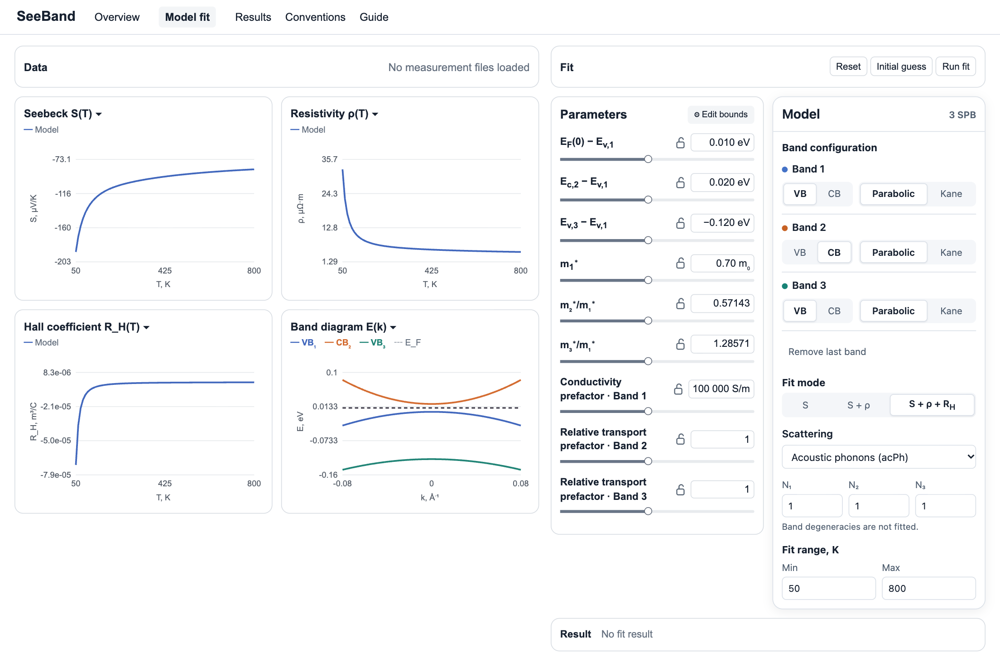
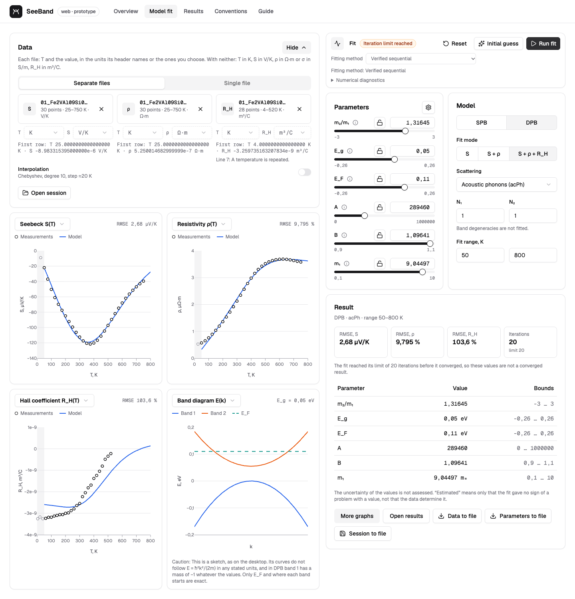
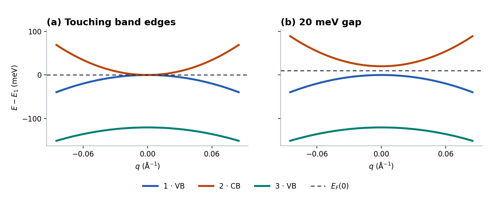

# Зонные модели в SeeBand Web

**Технический проект для рецензирования · 21 ноября 2026 · редакция 0.7**

**Статус.** Концепция для ревью на базе P18, ревизия `8e4f98d`. Явное двухзонное параболическое ядро относится к архивной ревизии P18. Проверки, доступные из ветки PR, перечислены в [руководстве рецензента](band-composition-v0.7/REVIEW.md). Конструктор, обобщение до трёх зон и подключение акустической зоны Кейна требуют реализации. Численные проверки приведены в разделах 7 и 10–14.

**Принятое решение по интерфейсу · 21 ноября 2026.** Для трёх зон согласована постоянная строка **Band gap · E_g** вверху Parameters. Она показывает энергетическую щель выбранных зон и подписывает края, которые её определяют. Фит использует два независимых смещения относительно первой зоны. Поведение при смене определяющей зоны, перекрытии и неполных данных закреплено в §15.1. Решение относится к интерфейсу; допуск транспортного ядра рассматривается отдельно в §§7–8.

## 1 Что увидит исследователь

В существующей карточке **Model** исследователь задаёт состав по строкам. Название вычисляется автоматически. В **Parameters** он вводит значения, фиксирует параметры и задаёт границы фита. Fit mode, Scattering, Nᵢ и температурный диапазон остаются в Model. Отдельного выбора p/n в новом составе нет.

Одна зона даёт SPB или SKB, две — DPB или 1 SKB + 1 SPB, три — 3 SPB или 1 SKB + 2 SPB. Для полностью параболического состава доступны acPh, dis, ionized и acPh + dis. При выборе Kane остаётся один доступный механизм — acPh.



**Макет A. Весь экран Fit.** Слева Data и четыре существующих слота графиков. Справа сверху действия Fit, ниже Parameters и Model, затем Result. В примере нет измерений и выполненного фита. Цветные линии показывают прямой расчёт для заданных параметров. Размещение воспроизводит FitPage из P18. Подписи и ползунки на иллюстрации схематичны.

### 1.1 Что берём из действующего Fit



**Исходный экран.** Снимок из руководства проекта показывает расположение панелей на примере DPB. Значения и результат на нём относятся к демонстрации в руководстве. В ветке P18 к карточке Model уже добавлены выбор конфигурации двух зон и p/n. В P18 эти контролы описывал компонент `ExplicitDpbControls`.

На широком экране FitPage отдаёт правой колонке 600 px при ширине от 1200 px. Внутри неё Parameters находится слева от Model. Ниже 1200 px Data и графики идут перед Fit и настройками. Две карточки располагаются одна под другой, когда им не хватает ширины для двух колонок по 294 px с промежутком. У каждой карточки свой заголовок. Порядок на узком экране — Fit, Parameters, Model, Result. [Действующая компоновка](../../../apps/web/src/pages/FitPage.tsx).

### 1.2 Что меняется внутри Model и Parameters


**Макет B. Состояние с фотографии.** Читаем Band configuration сверху вниз: Band 1 — VB / Parabolic, Band 2 — CB / Parabolic, Band 3 — VB / Parabolic. Справа в заголовке вычисляется 3 SPB. Достигнут предел трёх зон, поэтому доступно Remove last band. Ниже находятся Fit mode, Scattering, N₁/N₂/N₃ и Fit range. У каждой зоны сохраняется её номер при пересечении краёв по энергии.

В соседнем Parameters показаны E_F, два смещения краёв, m₁, два отношения масс и амплитуды выбранного режима. Общая опора E₁ = 0 фиксирована. Стартовое значение редактируется полем и ползунком, значок замка управляет фиксацией, кнопка в заголовке открывает существующий редактор границ. Для рисунка взяты E₂ − E₁ = 0.020 эВ, E₃ − E₁ = −0.120 эВ, E_F = 0.010 эВ, m₁ = 0.70 mₑ, m₂ = 0.40 mₑ, m₃ = 0.90 mₑ, A = 100 000 См/м, B₂ = B₃ = N₁ = N₂ = N₃ = 1. Графики макета A получены в акустическом пределе скрипта из раздела 14 при 50–800 K. Буквы A и B в этом расчёте — ключи формулы. Публичные подписи определены в §15. Положение ручек на рисунке иллюстративно. Индивидуальные границы задаёт исследователь.

### 1.3 Переход от DPB к смешанной модели


**Макет C. Две зоны, одна Kane.** Начиная с макета B, нажимаем Remove last band. Заголовок становится DPB, исчезают строка Band 3, N₃ и параметры третьей зоны. У Band 2 выбираем Kane. Заголовок меняется на 1 SKB + 1 SPB. В Parameters появляется непараболичность Band 2. Поля Band 1 и выбранные для них границы сохраняются. У Band 1 вариант Kane заблокирован. Fit mode по-прежнему выбирает набор наблюдаемых, а Scattering допускает только acPh.

Если до выбора Kane был задан dis, ionized или acPh + dis, макет предлагает сначала выбрать acPh. Автоматическая смена механизма скрыла бы научно существенное решение. Чтобы перенести Kane на другую зону, исследователь возвращает текущую к Parabolic. Add band создаёт последнюю строку с параболической дисперсией, при одной зоне удаление недоступно. Выбор механизма или состава сам по себе не запускает оптимизатор.

### 1.4 Где именно менять проект

| Участок P18                                                        | Изменение и критерий проверки                                                                                                                                                                                                                                                                                  |
| ------------------------------------------------------------------ | -------------------------------------------------------------------------------------------------------------------------------------------------------------------------------------------------------------------------------------------------------------------------------------------------------------- |
| FitPage, FitPanel, DataBar, ResultPanel                            | Сохранить текущую компоновку, загрузку измерений, кнопки и результат. Проверить широкий и узкий экран. Исполненный результат хранит состав, на котором был получен.                                                                                                                                            |
| ModelPanel → ModelControls, ExplicitDpbControls, selection.ts      | Заменить ручные SPB/DPB, старый список VB+CB и p/n строками зон для нового контракта. Использовать существующие группы кнопок и общие поля Model. Поля N строятся по длине списка, а допустимые режимы и механизмы определяет описание сервера. Подпись DPB или 3 SPB служит для отображения.                  |
| store.ts, ParametersPanel, parameters.ts, BoundsEditor             | Сейчас параметры, границы и фиксации адресуются через mode.id и имя параметра. Расширить идентификацию зон стабильным ID. Изменение Band 2 обновляет подходящие поля за один переход состояния. Сохранить совместимые значения, hold и границы Band 1. Для удалённой зоны убрать активные поля из запроса.     |
| liveCurves.ts → calcRequest, fitRequest.ts → fitRequest, ChartGrid | Для нового состава оба построителя читают один снимок зон, кратностей, настроек и параметров. Путь предсказания обновляет существующие слоты. E(k) получает по одной кривой на зону и одну линию E_F. Fit запускается существующей кнопкой. Результат запоздалого запроса не заменяет график нового состояния. |
| models.py, calc.py, band_diagram.py, fit.py, sessionFile.ts        | Добавить вариант данных и маршрутизацию к физическому ядру внутри действующих API. Существующие описания и методы нужны для чтения прежних сессий. Для новых формул требуется допуск ядра по разделу 8. Первым сквозным примером служит воспроизведение SPB/DPB, затем подключаются новые составы.             |

**Что проверить сквозным сценарием.** Загрузить измерения, выбрать DPB и задать собственные границы и фиксацию для Band 1. Добавить третью зону, сменить режим S на S + ρ + Hall и сверить сохранённые поля. Удалить третью зону, сделать Band 2 зоной Кейна и проверить доступность Scattering. После Run fit сравнить результат с повторным calc по конечному вектору. Сохранить и открыть сессию, сверить типы, ID, кратности, границы и кривые. Для старой сессии сохранить исходный результат и явно запросить недостающие параметры по разделу 6. Тест считается сквозным после выполнения на приложении с реальным API.

**Точки входа для ревью кода.** [ModelPanel](../../../apps/web/src/model/ModelPanel.tsx), [выбор модели и режима](../../../apps/web/src/model/selection.ts), [состояние сессии](../../../apps/web/src/session/store.ts), [ParametersPanel](../../../apps/web/src/model/ParametersPanel.tsx), [редактор границ](../../../apps/web/src/model/BoundsEditor.tsx), [запрос кривых](../../../apps/web/src/model/liveCurves.ts), [запрос фита](../../../apps/web/src/model/fitRequest.ts), [четыре панели графиков](../../../apps/web/src/model/ChartGrid.tsx).

## 2 Параметры образца и наблюдаемые величины

| Ввод                | Смысл и поведение                                                                                                                                                                                                                                                                   |
| ------------------- | ----------------------------------------------------------------------------------------------------------------------------------------------------------------------------------------------------------------------------------------------------------------------------------- |
| Тип, дисперсия и Nᵢ | Задаёт исследователь. Nᵢ считает эквивалентные долины. Спиновый множитель 2 учитывается в плотности состояний ровно один раз. Фит не определяет ни кратность, ни число зон.                                                                                                         |
| E₁ = 0, Eᵢ − E₁     | E₁ фиксирует начало отсчёта. Для двух зон одна независимая энергия края, для трёх — две. Допустим любой знак смещения. При смене порядка краёв номер зоны сохраняется.                                                                                                              |
| E_F                 | Общая энергия Ферми при нулевой температуре относительно края 1 (E₁ = 0). На экране без суффикса (0); конечная температура обозначается μ(T). Может быть задана, удержана или подобрана в пределах исследовательских границ. Значение внутри щели допустимо для смешанного состава. |
| m₁, Mᵢ = mᵢ/m₁      | Положительные изотропные массы одной долины у края, абсолютные массы в единицах mₑ. В S и S + ρ абсолютный масштаб задаёт исследователь. При наличии Hall подбор m₁ разрешён, если измерения чувствительны к масштабу.                                                              |
| αᵢ и нормировки     | У Kane может появиться параметр непараболичности, эВ⁻¹. Выбор его публичной формы требует согласования с SKB. Параметры проводимости и рассеяния появляются по описанию реализованного ядра.                                                                                        |
| Результаты          | S в В/К, ρ в Ом·м, R_H в м³/Кл, n и p в м⁻³. Диаграмма показывает дисперсии и одну линию E_F. Температурная кривая μ(T) выводится отдельно.                                                                                                                                         |

Для пары одного типа показываем расстояние между краями |Eⱼ − Eᵢ|. Для смешанного набора вычисляем d = min(E_CB) − max(E_VB). При d > 0 показываем щель модели d, при d < 0 — перекрытие |d|, при равенстве — нулевую щель модели. Из одних CB или одних VB щель материала определить нельзя. Эти три подписи не добавляют степеней свободы в фит. Параметр αᵢ характеризует конкретную дисперсию. Привязка αᵢ к обратной прямой щели требует самостоятельного обоснования даже при наличии наблюдаемого смещения между карманами.

Новая зона создаётся параболической. Если зона Кейна уже выбрана, в остальных строках Kane недоступен с указанием занятой строки. Чтобы перенести непараболичность, исследователь явно меняет старую зону на Parabolic и выбирает Kane у новой. Квота применяется к объявленному типу, в том числе при α = 0. Сервер отклоняет запрос с двумя Kane до расчёта. Добавление зоны сохраняет значения, границы и фиксации остальных зон по их идентификаторам. Новая строка получает собственную кратность и набор параметров. Значения по умолчанию помечаются как стартовые предположения. Смена Parabolic/Kane меняет доступность α только в этой строке. При смене конфигурации активный фит отменяется либо изменение блокируется до его завершения. Запоздалый ответ старого запроса не должен заменить актуальные кривые. Изменение параметров или структуры помечает прежний результат как относящийся к прежнему расчёту.

## 3 От энергии Ферми к балансу носителей



**Рисунок 1.** Состав VB₁ + CB₂ + VB₃ одинаков. Слева края первых двух зон совпадают с E_F. Справа CB₂ выше VB₁ на 20 мэВ, E_F выше VB₁ на 10 мэВ. Третья зона в обоих случаях лежит на 120 мэВ ниже VB₁. Массы иллюстративны. Координата q отсчитана от собственного экстремума каждой зоны. Совмещение вершин по горизонтали не устанавливает прямую щель материала.

Рассматриваем независимые трёхмерные изотропные долины с жёсткими краями. Пусть sᵢ = +1 для CB и −1 для VB, e > 0, заряд носителя qᵢ = −sᵢe. Кинетическая энергия u ≥ 0 отсчитывается внутрь зоны, полная электронная энергия равна Eᵢ + sᵢu. В формулах этого и следующего разделов энергии в джоулях, mᵢ в килограммах, αᵢ в Дж⁻¹. На границе API энергии с суффиксом _k означают E/k_B. Для перевода α из эВ⁻¹ в Дж⁻¹ делим численное значение на число джоулей в одном эВ.

**Геометрия.** Положим γᵢ(u) = u(1 + αᵢu) = ℏ²k²/(2mᵢ). При αᵢ = 0 получаем параболу. Для неограниченной ветви предложена область αᵢ ≥ 0. Численно устойчивое обращение даёт u = 2x/(1 + √(1 + 4αᵢx)), где x = ℏ²k²/(2mᵢ). Эту же дисперсию должны использовать диаграмма, плотность состояний и скорости.

**Нулевая температура.** Для каждого пробного вектора фита находим u_Fi = max[sᵢ(E_F − Eᵢ), 0]. Заполнение сферы в k-пространстве даёт Cᵢ(0) = Nᵢ k_Fi³/(3π²), где k_Fi = √(2mᵢγᵢ(u_Fi))/ℏ. Целевой знаковый избыток D = Σᵢ sᵢ Cᵢ(0) имеет размерность м⁻³. Внутри одного температурного расчёта D постоянен. При изменении пробных параметров, в том числе массы, он вычисляется заново. Отдельный ввод концентрации или её знака в новом режиме не требуется.

**Конечная температура.** Число состояний на объём и единицу энергии равно gᵢ(u) = [Nᵢ/(2π²)] · (2mᵢ/ℏ²)³ᐟ² √γᵢ(u) (1 + 2αᵢu). Обозначим ζᵢ = sᵢ(μ − Eᵢ). Тогда Cᵢ(T, μ) = ∫ gᵢ(u) f(u − ζᵢ,T) du по u от 0 до ∞. Ядро решает одно уравнение Σᵢ sᵢ Cᵢ(T, μ) = D. С повышением μ электронное заполнение растёт, дырочное падает. Левая часть строго возрастает при T > 0 и положительных долинных весах, поэтому существующий конечный корень единственен.

**Границы применимости.** В наборе только из CB нужен D > 0, только из VB — D < 0. При нулевом заполнении такого набора конечного корня при T > 0 нет. Смешанный набор допускает оба знака и D = 0. При положительной щели все позиции E_F внутри замкнутого интервала дают D = 0 и одинаковые μ(T) и транспорт при прочих равных. Фит не различит эти позиции даже на идеальных данных. При перекрытии D = 0 может означать конечные равные электронное и дырочное заполнения. Два противоположных заряда при таком балансе могут давать ненулевой Hall.

## 4 Рассеяние и транспорт

Для независимых карманов в слабом магнитном поле вычисляем скалярные канальные коэффициенты. Пусть Kᵣᵢ = ∫ [gᵢvᵢ²τᵢ/3] (u − ζᵢ)ʳ (−∂f/∂u) du. Тогда σᵢ = qᵢ²K₀ᵢ и Sᵢ = K₁ᵢ/(qᵢTK₀ᵢ). При T > 0 температурное окно расширяется вокруг μ(T). Все объявленные зоны входят в интеграл, включая нижнюю VB на рисунке 1. Предварительное отбрасывание по пересечению линии E_F даёт физически другой результат.

**Наблюдаемые кривые.** При σ = Σσᵢ и wᵢ = σᵢ/σ имеем ρ = 1/σ, S = ΣwᵢSᵢ и R_H = Σwᵢ²R_Hᵢ. Электронное и дырочное слагаемые Hall имеют противоположные знаки. При точной компенсации относительная ошибка суммарного Hall плохо определена. Для электронного числа Лоренца обобщение на три зоны даёт L = ΣwᵢLᵢ + Σwᵢ(Sᵢ − S)². Суммарную кривую и разложение по зонам вычисляем на одной μ(T) и одном наборе весов.

Для изотропной зоны Кейна vᵢ² = 2γᵢ/[mᵢ(1 + 2αᵢu)²], циклотронная масса m_cᵢ(u) = mᵢ(1 + 2αᵢu). В скалярном приближении времени релаксации знаковый числитель слабополевого Hall равен Hᵢ = (qᵢ³/3)∫gᵢ vᵢ² τᵢ² (−∂f/∂u)/m_cᵢ du, R_Hᵢ = Hᵢ/σᵢ². Принята ориентация R_H < 0 для электронной зоны. Вклад с очень малой σᵢ удобнее складывать через Hᵢ, минуя деление на исчезающую σᵢ². Схема предполагает независимые карманы, изотропию, слабое поле и внутридолинное рассеяние. Рисунок касания не доказывает отсутствие гибридизации, линейной дисперсии или межзонных переходов.

| Выбор в Model      | Контракт для параболических зон                                                                                                    | Условие допуска Kane                                                                                                          |
| ------------------ | ---------------------------------------------------------------------------------------------------------------------------------- | ----------------------------------------------------------------------------------------------------------------------------- |
| acPh + dis         | Предлагается вернуть совместное акустическое и сплавное рассеяние по правилу Маттиссена. Формулы, единицы и проверки в разделе 14. | Вне области проекта для любого состава с Kane.                                                                                |
| Acoustic phonons   | Текущий закон τ ∝ T⁻¹u⁻¹ᐟ². В P18 амплитуда проводимости A и относительный вес B.                                                  | Акустическая модель Lin–Liu, формулы и численный эталон в разделах 12–13. До включения проверить реализацию и межзонные веса. |
| Alloy disorder     | τ ∝ u⁻¹ᐟ². Нормировка F и относительный вес G, в ядре множитель F·T.                                                               | Вне области проекта для любого состава с Kane.                                                                                |
| Ionized impurities | Принятый степенной закон τ ∝ u³ᐟ², множитель A·(T/300 K)³. Это феноменологическая модель ионизированных примесей.                  | Вне области проекта для любого состава с Kane.                                                                                |

Для трёх парабол при одном механизме предлагается расширить действующую нормировку P18. При M₁ = b₁ = 1 относительный множитель канала i равен (Nᵢ/N₁)bᵢ/Mᵢ, Mᵢ = mᵢ/m₁. S-only наследует соглашение bᵢ = 1, в S + ρ и S + ρ + Hall появляется по одному bᵢ для каждой дополнительной зоны при одной общей положительной амплитуде. Физик должен подтвердить такую параметризацию до её включения. Нулевая транспортная амплитуда зоны сохраняет её участие в балансе заряда. В смешанном Kane + parabolic модели согласование размерностей амплитуд требует отдельных эталонов.

## 5 Интерфейсы и состояние расчёта

**Контракт для обсуждения.** Новый дискриминатор `band_composition_v1` выбирает вычислительную ветвь в существующем реестре моделей. Клиент продолжает вызывать действующие HTTP-эндпоинты. Сервер публикует описание параметров и поддерживаемых комбинаций. Одни и те же идентификаторы и единицы используются в /api/calc, /api/fit и /api/band-diagram. Ниже фрагмент логической структуры для рисунка 1б. Конкретные имена новых полей предлагаются к обсуждению. E_F присутствует даже при собственном состоянии, carrier_type отсутствует.

```json
{
  "parameterization": "band_composition_v1",
  "bands": [
    { "id": "b1", "type": "vb", "dispersion": "parabolic", "valleys": 1 },
    { "id": "b2", "type": "cb", "dispersion": "parabolic", "valleys": 1 },
    { "id": "b3", "type": "vb", "dispersion": "parabolic", "valleys": 1 }
  ],
  "reference_band_id": "b1",
  "fit_mode": "s_rho_hall",
  "scattering": "acPh",
  "parameters": {
    "fermi_energy_k": 116.045,
    "b2.edge_offset_k": 232.09,
    "b3.edge_offset_k": -1392.54,
    "b1.mass_me": 0.7,
    "b2.mass_ratio": 0.57143,
    "b3.mass_ratio": 1.28571
  }
}
```

Энергии в примере округлены. Полный запрос добавляет диапазон температур и активные транспортные амплитуды из описания режима, fit-запрос передаёт измерения, start, held и bounds. Публичный ключ непараболичности — например, `b2.alpha_per_ev`. Идентификатор принадлежит зоне на протяжении её жизни. Пересечение краёв не переставляет массив. Новая зона получает свободный идентификатор и чистый набор параметров. Первая версия позволяет удалить последнюю зону, оставляя опорную на месте.

| Компонент            | Обязанность и проверяемый выход                                                                                                                                                                                                                                      |
| -------------------- | -------------------------------------------------------------------------------------------------------------------------------------------------------------------------------------------------------------------------------------------------------------------- |
| seeband_core         | Реестр проверяет состав и сочетание с механизмом. Из одного неизменяемого входа строятся плотности, μ(T), канальные моменты, суммарные кривые, статусы и производные расстояния.                                                                                     |
| FastAPI и OpenAPI    | Различают старый и новый варианты. Валидируют количество зон 1–3, уникальные ID, допустимые поля, положительные массы и кратности, максимум одну объявленную Kane. Ответ 422 содержит код, путь поля и причину. Пара Kane + Kane отклоняется и в двухзонном составе. |
| SeeBand Web          | Model выбирает структуру, режим, механизм и T. Parameters строит численные поля из метаданных. Запросы предсказаний привязаны к снимку конфигурации. Для временно неподдерживаемой комбинации показывается причина и перечень доступных режимов.                     |
| Результаты и экспорт | Сервер возвращает T, измеряемые кривые в SI, исходные band ID, версию ядра, законы, единицы, статусы и предупреждения. CSV/ZIP и повторный calc при одном снимке согласуются с графиком и конечным результатом fit.                                                  |

**Различимые исходы.** Валидная геометрия может дать диаграмму при невозможном транспортном состоянии. Нулевое заполнение однополярной системы сообщает ошибку состояния. Неконечная квадратура или непроверенный корень дают численную ошибку с T и доступной невязкой. Низкое качество аппроксимации возвращается как результат с остатками. Сбой сети имеет отдельное сообщение. Доступность транспорта определяется для требуемого набора выходов, поэтому отказ Hall не блокирует уже проверенный расчёт S.

## 6 Фит и совместимость

**Область оптимизации.** Свободные параметры получают от исследователя конечные границы и старт внутри них. Физическая область дополнительно требует положительных масс, положительной общей проводимости и допустимого баланса. Ограничения ползунков при ручном изменении одной координаты не сужают прямоугольник совместного фита. Для смешанной конфигурации разрешены пути через D = 0 и смену знака. Проверка `fermi_energy_carrier_mismatch` остаётся только у старого явно знакового контракта. Плохой старт, отсутствие независимой информации и выход за область модели должны различаться в результате.

**Целевая функция.** Для первых параболических режимов отправная точка — проверенный последовательный оцениватель P19. Этапы используют абсолютные остатки S, ρ и Hall со штатными масштабами 10⁶, 10⁸ и 10¹⁰ в SI. Вес механизма и измеряемой величины не подбирается для улучшения конкретного образца. Если изменение m₁, Mᵢ, αᵢ или края меняет несколько выходов, конечную точку перепроверяем без кэша во всех запрошенных каналах; фиксированные параметры и пользовательские границы сохраняются точно. Алгоритм или веса с иной целью получают собственную версию и эталоны.

**Что можно извлечь.** Для чисто параболической системы общий множитель масс масштабирует плотности при фиксированном E_F, а отношения масс и нормировки могут сохранить S и ρ. Hall может дать информацию об абсолютной массе при заданных кратностях и механизме. Совпадающие зоны, почти пустая третья зона и обмен α с массой, краем или относительным весом создают почти одинаковые кривые. Внутри щели чувствительность к E_F равна нулю. Проверки включают профиль остатка, несколько стартов, ранг масштабированного Якобиана вдали от изломов, активные границы и статус неопределённости. Для собственного старта, которому разрешён выход за край, проверяются односторонние пробы в границах. При плоском профиле результат сообщает допустимый интервал или недостаток информации.

**Данные прошлых версий.** Текущий файл сессии имеет оболочки v1/v2. Новый состав получает предложение версии v3. Загрузка сначала проверяет версию и контрольную сумму, затем сохраняет исходные входы, единицы, bounds, held, алгоритм и прежний результат для воспроизведения. Старый SPB и исторический DPB исполняются прежним путём. У legacy DPB нельзя молча выводить абсолютную массу и кратности из отношения масс. Для перехода старых S и S + ρ требуется подтверждение Nᵢ и |m₁|; отмена сохраняет текущую работу.

При импорте `explicit_fermi_v1` допустимую точку можно отобразить на те же зоны, массы и E_F. Старая p/n-ветвь сохраняется в метаданных исторического результата. Новая оптимизация вправе пересечь прежнюю границу знака, что явно сообщается исследователю. Для `explicit_density_v1` восстанавливаем E_F по D лишь при единственном решении. При D = 0 в щели сохраняем интервал, предлагаем исследователю выбрать старт. Границы D не переводятся механически в границы E_F. Миграция считается завершённой после независимого пересчёта фиксированной точки в доступных каналах, с отчётом о расхождениях или об отсутствии однозначного соответствия.

## 7 Воспроизводимые результаты

**Архивный прогон P18-BASE.** На ревизии `8e4f98d` повторно выполнены три группы: домены прежней p/n-модели, явный параболический транспорт и явный двухзонный фит. Прошли 113 тестов. Они включают сравнение с независимыми SI-интегралами, перестановки, широкий зазор и синтетические фиты. В старом полном прогоне у инфраструктурного теста остался дочерний процесс после завершения. Отдельный повтор этого теста прошёл. Полный прогон новой модели ещё предстоит.

**Независимый эксперимент.** Скрипт использует только стандартную библиотеку Python, интегрирует напрямую в радиальном k-пространстве и решает баланс бисекцией. Массы в единицах mₑ, энергии в эВ. В примере gap-3 берём VB₁ (0; 1,2; N=1), CB₂ (+0,20; 0,3; N=2; α=1 эВ⁻¹) и VB₃ (−0,06; 0,7; N=1). Обе VB параболические. Эти параметры специально отличаются от геометрического эскиза на рисунке 1. Для всех зон τ = 10⁻¹⁴ с. Два старта E_F, 0,04 и 0,16 эВ, дают D = 0 и совпадающие μ(T). Расчёт σ здесь проверяет температурную активацию при постоянном τ.

| T, K | μ, эВ       | Дырки в VB₃, м⁻³ | Доля VB₃ в σ |
| ---- | ----------- | ---------------- | ------------ |
| 150  | 0,108679450 | 1,118 × 10¹⁹     | 0,1540 %     |
| 300  | 0,117380472 | 1,539 × 10²²     | 1,5763 %     |
| 600  | 0,136068896 | 9,299 × 10²³     | 5,0219 %     |

Та же программа проверяет 2 зоны с щелью, 3 зоны с касанием и одну электронную зону с D > 0. Все перестановки трёх зон сохраняют μ. На девяти нейтральных точках максимальная нормированная невязка равна 1,303 × 10⁻¹³. Удвоение числа интервалов с 800 до 1600 изменило n и σ относительно не более чем на 2,220 × 10⁻¹⁶; отдельное удлинение хвоста с 50 до 60 k_BT — на 3,331 × 10⁻¹⁶. Это сходимость выбранных примеров. Дополнительные проверки воспроизводят σ = ne²τ/m для одной параболы, предел α → 0, закон плотности m³ᐟ² и отклонение двух непараболических зон.

**Как повторить из корня checkout.** Для первого запуска достаточно Python 3.10+; отчёт получен в Python 3.13.18. Для второго нужна штатная среда проекта.

```sh
python3 scripts/verify_band_composition_design.py
uv run pytest -q packages/seeband_core/tests/test_carrier_domain.py \
  packages/seeband_core/tests/test_explicit_transport.py \
  packages/seeband_core/tests/test_explicit_dpb_fit.py
```

Эксперимент рассчитывает плотности, μ и σ при постоянном τ. Реализации S, Hall и оптимизации трёх зон в нём нет. Точные совпадения с конечными сетками не определяют допустимый диапазон всех параметров. Доказательства для механизма рассеяния и для физической применимости к реальному образцу рассматриваются отдельно.

## 8 Матрица доказательств перед выпуском

Для B зон есть 2ᴮ вариантов VB/CB и B+1 способов выбрать положение единственной Kane либо оставить все зоны параболическими. При B = 1, 2, 3 получаем 4, 12 и 32 упорядоченных состава. При четырёх вариантах Scattering и трёх fit mode получаем 576 запросов. **270 допустимых по проекту** составляют 14 полностью параболических составов × 4 × 3 = 168 и 34 состава с одной Kane × 1 × 3 = 102. Остальные 306 должны отклоняться как несовместимые: Kane с dis, ionized или acPh + dis. Это план проверок; на данном этапе разрешённый, но ещё не реализованный расчёт должен возвращать явный статус недоступности. Запрещённые две Kane проверяются отдельно, включая α = 0, перестановки и попытку восстановления из файла.

| ID и утверждение        | Независимая проверка                                                                                                                        | Критерий приёмки                                                                                                                                                                              |
| ----------------------- | ------------------------------------------------------------------------------------------------------------------------------------------- | --------------------------------------------------------------------------------------------------------------------------------------------------------------------------------------------- |
| A1. Геометрия и единицы | Собрать 1–3 зоны, поменять знак каждого края, α → 0, проверить отражение CB↔VB и k относительно экстремума.                                 | У края верная энергия и кривизна; при известном E_F ровно один пунктир. Отображаемые эВ, K в API и Å⁻¹ согласуются.                                                                           |
| A2. Баланс              | Сравнить DOS-интеграл с радиальным k-интегралом для щели, касания, перекрытия, D обоих знаков и D = 0. Изменить порядок температур.         | У каждого T конечен корень, r = abs(ΣsC − D)/max(ΣC, abs(D)) ≤ 10⁻¹² при положительном масштабе, либо возвращена явная ошибка точности.                                                       |
| A3. Знаки и симметрии   | Отразить края, E_F и типы; переставить зоны с переносом опоры, масс и нормировок. Сравнить эквивалентные разбиения при одинаковой μ.        | S и R_H меняют знак при отражении, ρ сохраняется. При перестановке суммарные кривые совпадают. Два идентичных канала удваивают σ и вдвое уменьшают R_H при неизменной μ.                      |
| A4. Транспорт           | На сетке (состав, механизм, режим) сравнить моменты в u и k. Проверить вклад каждой зоны, предел Drude, болцмановский и вырожденный режимы. | Положительные σ, ρ, конечные значения; суммы воспроизводят общие S и Hall. Для параболических невырожденных Hall-факторов ориентиры 3π/8 при acPh/dis и 315π/512 при ionized.                 |
| A5. Фит                 | Синтетические идентифицируемые и вырожденные примеры. Повтор с другого старта, с удержанием параметра и со стартом в щели.                  | Для первого класса воспроизводятся эталонные кривые и идентифицируемые параметры. Для второго фиксируется плоский профиль или неоднозначность. Реальный образец может дать плохой остаток.    |
| A6. Сквозной путь       | Настоящий API: Model → Parameters → calc → fit → Results → ZIP → открыть сессию. Изменить состав при ожидающем ответе; импортировать v1/v2. | Стабильные band ID, Nᵢ и единицы, прежние границы выживших зон; равенство результата последнему вектору и повторному calc. Проверить 422, отмену и невозможность второй Kane при 2 и 3 зонах. |

Численную сетку расширяют независимо по температуре (включая 50 и 800 K), краям (включая ±3 эВ), ε-масштабу около нуля, отношениям масс, Nᵢ ≠ 1, αk_BT и почти взаимно компенсирующимся Hall-вкладам. Порог 2 × 10⁻¹¹ в демонстрационном скрипте — контроль эталонного интегратора; производственный P18 проверяет 10⁻¹². При нормировании нулём или непредставимом масштабе выдаётся численная диагностика.

Для сравнения кривых предлагаем стартовый бюджет для одинаковых констант и независимой сходящейся квадратуры: относительная ошибка положительной ρ ≤ 10⁻⁶, ошибка S ≤ 10⁻¹⁰ В/К + 10⁻⁶ Σ|wᵢSᵢ|, ошибка R_H ≤ 10⁻⁶ Σ|wᵢ²R_Hᵢ| с отдельной проверкой симметричного нуля по машинной ошибке ненулевых слагаемых. Сначала удваиваем сетку и увеличиваем хвост отдельно, проверяем, что ошибка эталона меньше одной десятой бюджета. Для старых физических констант и золотых файлов применяется отдельный отчёт о совместимости. Эти пороги подлежат согласованию по шкалам наблюдаемых до фиксации эталонов.

## 9 Этапы внедрения и вопросы коллегам

1. **Состав и описание.** Согласовать ID, единицы, предел в одну Kane, схемы ошибок и миграцию. Вывести новый Model рядом с существующим Parameters за версией контракта. Демонстрация этапа — добавление третьей зоны, сохранение N₁/N₂ и запрет второй Kane без изменения первой.
2. **Параболическая совместимость.** Провести новый путь через 1–2 зоны и сверить старые фиксированные точки по S, ρ, Hall. Убрать ограничение p/n только из нового варианта. Включить 3 параболы после A1–A4, затем фит и экспорт после A5–A6.
3. **Одна Kane.** Сверить с отдельной работой по SKB единицы α, массу у края, нормировку и рассеяние. По одному открывать подтверждённые сочетания с 0–2 параболическими зонами. Для каждого из трёх fit mode с acPh требуется независимый расчёт и разбор расхождений. Условие «не более одной Kane» сохраняется на каждом этапе.
4. **Решение о выпуске.** Для конкретной ревизии приложить матрицу выполненных тестов, входные наборы, значения ошибок и ссылки на артефакты; записать заключение физика, численного рецензента и владельца API. Возврат к прежней версии интерфейса использует прежние пути исполнения и сохранённые оригиналы сессий.

| Вопрос для комментария                                                                                                                               | Решение, которое зависит от ответа                                                                                                       |
| ---------------------------------------------------------------------------------------------------------------------------------------------------- | ---------------------------------------------------------------------------------------------------------------------------------------- |
| Q1. Достаточна ли для наших образцов модель постоянного D без вымерзания примесей, ловушек и изменения краёв с T?                                    | Граница применимости и формулировка предупреждения.                                                                                      |
| Q2. Как интерпретируем Nᵢ у вырожденного края? Разрешены ли дробные эффективные кратности старых сессий?                                             | Предложение — вводить целое число эквивалентных долин для новых образцов; старые положительные значения сохранять с их исходным смыслом. |
| Q3. Как задавать относительную амплитуду акустического канала Kane при смешении с параболами? Какие наборы измерений оправдывают свободные α или m₁? | Первая доступная матрица рассеяния и параметры в Parameters.                                                                             |
| Q4. Как представлять неопределимый E_F внутри щели и близкие решения при нескольких массах?                                                          | Отдельный статус результата и способ представить исследователю профиль или допустимый интервал.                                          |
| Q5. Достаточны ли границы точности A2–A4 и какие независимые эталоны или материалы добавить?                                                         | Численные бюджеты, регрессионные случаи и критерии публикации.                                                                           |

Просьба указывать номер вопроса или проверки, состав зон, наблюдаемую величину и пример, который подтверждает вывод или служит контрпримером. Наиболее ценный комментарий — конкретная ситуация, в которой предложенная трактовка даст неверную кривую либо слишком уверенную интерпретацию параметра.

**Код для сверки.** [Экран Fit](../../../apps/web/src/pages/FitPage.tsx), [архивное сравнение явного ядра P18](band-composition-v0.7/REVIEW.md), [правила фита P19](../../../packages/seeband_core/docs/verified-sequential-fit.md), [параболический ionized](../../../packages/seeband_core/docs/ionized-impurities.md), [разбор множителя Hall](../../../packages/seeband_core/docs/dpb-hall-prefactor.md), [формат сессии](../../../apps/web/src/session/sessionFile.ts), [скрипт для повторения](../../../scripts/verify_band_composition_design.py).

**Физические источники.** Уравнения переноса в приближении времени релаксации и температурное окно — [документация VASP](https://vasp.at/wiki/Electronic_transport_coefficients) и [Madsen, Carrete, Verstraete, BoltzTraP2](https://arxiv.org/abs/1712.07946). Основной источник для однозонного акустического транспорта Кейна — [SKBcal, Scientific Reports](https://doi.org/10.1038/s41598-022-09734-4). Исходная модель и её допущения — [описание SeeBand](https://arxiv.org/html/2409.06261v2). Для абсолютной нормировки Hall дополнительно нужен независимый вывод, приведённый в проектном разборе выше.

## 10 Параболическая зона. Вывод для одного канала

**Откуда брать формулы.** Ближе всего к задаче SeeBand основная статья проекта. В уравнениях (1)–(10) и Supplementary Note 3 авторы связывают параметры зон с S, ρ и Hall, включая сумму по N зонам. Для произвольного степенного времени релаксации удобны две независимые сверки. Уравнения (1)–(3) в _Thermopower, figure of merit and Fermi integrals_ дают σ, S и L. Работа _Efficacy of the Method of Four Coefficients to Determine Charge-Carrier Scattering_ выводит электрические и холловские величины из одного степенного закона. Здесь используем SI и приводим нормировки к одному соглашению. [SeeBand и дополнительные материалы](https://www.nature.com/articles/s41524-025-01645-y), [продольные интегралы](https://doi.org/10.1038/s41598-021-03760-4), [Hall при степенном рассеянии](https://doi.org/10.1103/PhysRevApplied.16.024004).

**Единицы.** В размерных выражениях m — масса одной долины в кг, N — число долин, q = −e для CB, +e для VB, e = 1.602176634 × 10⁻¹⁹ Кл, k_B = 1.380649 × 10⁻²³ Дж/К, ℏ = h/(2π), h = 6.62607015 × 10⁻³⁴ Дж·с. Для ввода массы умножаем m/mₑ на mₑ ≈ 9.10938 × 10⁻³¹ кг. Пересчёт единиц выполняется до интегрирования. При воспроизведении прежних результатов нужно учитывать округление физических констант в ядре.

**Число носителей.** u = ℏ²k²/(2m), v² = 2u/m. Положим G = N(2m/ℏ²)³ᐟ²/(2π²), тогда g(u) = G√u. При x = u/(k_BT), η = s(μ − Eᵢ)/(k_BT) распределение f = 1/[1 + exp(x − η)]. Положительное окно W = f(1 − f) равно −∂f/∂x. В размерных интегралах −∂f/∂u = W/(k_BT). Ненормированный интеграл Fⱼ(η) = ∫₀^∞ xʲ f dx, j > −1. Поэтому C = G(k_BT)³ᐟ² F(1/2). Здесь и далее индекс 1/2 означает порядок интеграла. В единственной заполненной зоне баланс раздела 3 сводится к F(1/2)(η) = (2/3)[u_F/(k_BT)]³ᐟ².

**Время релаксации.** Пусть τ = τ₀(T/T₀)ᵝ(u/u₀)ʳ, где τ₀ в секундах, T₀ = 300 K, u₀ = k_BT₀, λ = r + 1/2. В обозначениях статьи о продольном переносе их спектральная степень равна λ + 1. Для сокращения ниже F(j) означает Fⱼ(η). Все коэффициенты в правых частях определены при одной η.

**P1 · Электропроводность.** σ = [2e²G/(3m)] τ₀(T/T₀)ᵝ u₀^(−r) (k_BT)^(λ+1) (λ+1) F(λ). Удельное сопротивление ρ = 1/σ. Множитель 1/3 происходит от углового среднего vₓ². В степень энергии входят плотность состояний, скорость в квадрате и τ.

**P2 · Термоперенос.** Введём X = (λ+2)F(λ+1)/[(λ+1)F(λ)] и Y = (λ+3)F(λ+2)/[(λ+1)F(λ)]. Тогда S = (k_B/q)(X − η), L = (k_B/e)²(Y − X²), κₑ = LσT. Единицы S, L и κₑ соответственно В/К, В²/К² и Вт/(м·К). Коэффициент мощности равен S²σ.

**P3 · Слабополевой Hall.** hλ = (2λ + 1/2)/(λ+1)². Безразмерный r_H = (3/2) hλ F(1/2) F(2λ−1/2)/F(λ)². Размерный R_H = r_H/(qC), в м³/Кл. Равносильная запись R_H = [3π²ℏ³/(qN(2mk_BT)³ᐟ²)] hλ F(2λ−1/2)/F(λ)². Холловская подвижность равна σ abs(R_H). Порядок F(2λ−1/2) возникает из τ². Нормировка даёт r_H → 1 в вырожденном пределе. Соглашение о множителе 3 и его проверка разобраны в [заметке проекта](../../../packages/seeband_core/docs/dpb-hall-prefactor.md).

$$
R_H=\frac{3\pi^2\hbar^3}{qN(2mk_BT)^{3/2}}\,\frac{2\lambda+1/2}{(\lambda+1)^2}\,\frac{F_{2\lambda-1/2}(\eta)}{F_\lambda(\eta)^2}
$$

## 11 Рассеяние в SPB и сборка нескольких парабол

| Механизм           | (r, β, λ) и проводимость первой зоны | Моменты X и Y                        | Hall                   |
| ------------------ | ------------------------------------ | ------------------------------------ | ---------------------- |
| Acoustic phonons   | (−1/2, −1, 0). σ₁ = A F(0)           | X = 2F(1)/F(0), Y = 3F(2)/F(0)       | hλ = 1/2, порядок −1/2 |
| Alloy disorder     | (−1/2, 0, 0). σ₁ = F·T·F(0)          | Те же X и Y, как у acPh              | hλ = 1/2, порядок −1/2 |
| Ionized impurities | (3/2, 0, 2). σ₁ = A (T/T₀)³ F(2)     | X = 4F(3)/[3F(2)], Y = 5F(4)/[3F(2)] | hλ = 1/2, порядок 7/2  |

A [См/м] и F [См/(м·К)] — положительные амплитуды фита. Буква F без аргумента в произведении F·T обозначает амплитуду alloy. Безразмерные B (acPh, ionized) и G в интерфейсе (dis) задают относительную проводимость второй зоны. Буква G в формуле плотности состояний раздела 10 обозначает отдельно определённый размерный коэффициент. При фиксированной η проводимости трёх механизмов пропорциональны T⁰, T¹, T³. На образце η(T) меняется, поэтому это разные проверки. Степень r = 3/2 предполагает постоянную амплитуду без поправки на экранирование.

**DPB и третья парабола.** Вычисляем собственные ηᵢ из одного μ(T). В формулах раздела 10 используем mᵢ и Nᵢ каждой строки. При эмпирической нормировке P18 берём σᵢ = a(T) (Nᵢ/N₁)(bᵢ/Mᵢ) Fλ(ηᵢ), где a(T) — A, F·T или A(T/T₀)³ из таблицы. b₁ = M₁ = 1. Такая запись уже включает массу и кратность в относительном весе. Для микроскопически заданных τ₀ᵢ вместо неё применяется полная P1. Умножение P1 ещё раз на тот же вес дублировало бы вклад. При одиночной зоне и одинаковых нормировках обе записи эквивалентны. Для одинаковых изотропных долин m_DOS = N²ᐟ³ m, поэтому m_DOS³ᐟ² = N m³ᐟ².

**Сумма транспортных каналов.** Обозначим Jᵢ = σᵢSᵢ, Hᵢ = σᵢ²R_Hᵢ. Складываем σᵢ, Jᵢ и Hᵢ, затем делим один раз. Для измерения при нулевом суммарном токе κₑ = Σ κₑᵢ + T Σ σᵢ(Sᵢ − S)². Добавка положительна при разных Sᵢ и присутствует также для двух каналов одного знака. Смена знака суммарного Hall возможна уже в двух разноимённых зонах. Первой измеренной точки S недостаточно, чтобы закрепить типы остальных зон.

**Выполненная проверка.** Независимый расчёт по радиальному k и аналитические P1–P3 сопоставлены в 36 случаях при η = −8, 0, 12, T = 150 и 600 K, N = 3, для CB и VB и всех трёх механизмов. Максимальные относительные расхождения для σ, S, L, R_H и C соответственно 5.09 × 10⁻¹¹, 3.39 × 10⁻¹¹, 1.53 × 10⁻¹⁰, 1.02 × 10⁻¹⁰ и 2.23 × 10⁻¹⁶. В больцмановском пределе получены r_H = 3π/8 и 315π/512. Метод проверяет знак и абсолютное значение Hall. [Скрипт для воспроизведения](../../../scripts/verify_spb_design_coefficients.py).

**Сверка публикаций и кода.** Физический рецензент проверил однозонный предел и суммирование для 2–3 зон. В основном тексте SeeBand, уравнение (7), пропущен множитель 3. Его восстановление согласуется с уравнениями (12), (17) Supplementary Note 3, пределом qCR_H → 1 и текущей функцией band_transport. В уравнениях (14), (18) приложения при нашем определении ηᵢ знак заряда должен умножать всю скобку в P2. В тепловой сумме из уравнения (9) приложения при Sᵢ² нужна собственная σᵢ. Для степенного Hall сверяемся также с Crawford и соавт. Их интегралы используют производную распределения и гауссовы единицы. Для p > 0 связь нормировок такова: ∫ xᵖ W dx = p F(p−1). [Статья и Supplementary Information](https://www.nature.com/articles/s41524-025-01645-y#Sec10), [Crawford и соавт.](https://arxiv.org/html/2103.04569).

**Архивная сверка DPB-HALL на P18.** В 27 сочетаниях VB+VB, VB+CB, CB+CB, трёх механизмов и трёх режимов сравнили прямой расчёт explicit_curves с независимыми формулами в 81 температурной точке. T = 100, 300, 800 K, N₁ = 2, N₂ = 6. Ошибки по шкале ненулевых слагаемых составили до 2.15 × 10⁻¹¹ для S и 2.55 × 10⁻¹¹ относительно результата для ρ. При CB+CB, alloy, S + ρ + Hall и 800 K получили R_H = −7.03804760164 × 10⁻⁶ м³/Кл, независимый расчёт дал −7.03803935555 × 10⁻⁶. Расхождение 1.172 × 10⁻⁶ укладывается в действующий допуск этой сверки 3 × 10⁻⁶ и превышает предложенный A4 порог 10⁻⁶. Причина требует проверки. Набор входов и команда включены в архив. Отдельный модуль тестов explicit_transport дал 38 успешных тестов. Эта сверка проверяет вычисление кривых при выбранном fit mode; оптимизацию параметров покрывает будущая проверка A5.

## 12 Одна зона Кейна. Акустическое рассеяние по Lin и Liu

Основной источник SKB — Fei-Hung Lin и Chia-Jyi Liu, _An algorithm of calculating transport parameters of thermoelectric materials using single Kane band model with Riemann integral methods_, Scientific Reports 12, 7056 (2022). Ниже записан расчёт для S, ρ и Hall по уравнениям (1)–(14), (19)–(26) статьи. Он замыкает акустическую часть раздела 4. [Оригинальная статья](https://doi.org/10.1038/s41598-022-09734-4).

**Геометрия и рассеяние.** Введём положительный масштаб E_K дисперсии этой долины. В статье E_K — прямая щель, используемая в однозонном приближении Кейна, и α = 1/E_K. В составе VB+VB, CB+CB или VB+CB смещение краёв других явно введённых зон не определяет E_K. Parameters хранит один независимый параметр непараболичности. В эталоне ε = k_BT/E_K, z = x(1+εx), d = 1+2εx, Q = d²+2, x = u/(k_BT). Энергия в знаменателе τ и E_def должна быть выражена в одной системе единиц с k_BT.

**K1 · Скорость рассеяния.** Из уравнения (23) получаем 1/τ = [(2m_D k_BT)³ᐟ² E_def²/(6πℏ⁴ C_l N)] √z Q/d. Здесь m_D = N²ᐟ³m_b — полная DOS-масса, m_b — масса плотности состояний одной долины у края, C_l — упругий модуль в Па, E_def — акустический деформационный потенциал в Дж. При ε → 0 и фиксированной u это даёт 1/τ ∝ T√u. Подстановка K1 в моменты раздела 4 даёт разные степени Q для продольного и холловского переноса.

$$
\frac{1}{\tau}=\frac{(2m_Dk_BT)^{3/2}E_{\rm def}^2}{6\pi\hbar^4 C_l N}\,\frac{\sqrt{z}\,Q}{d}
$$

**K2 · Пять интегралов.** В нашей нотации I(a,b,c) = ∫₀^∞ W xᵃ zᵇ Q^(c/2) dx, W определён в разделе 10. Пусть J₀ = I(0,1,−2), J₁ = I(1,1,−2), J₂ = I(2,1,−2), U = I(0,1/2,−4), V = I(0,3/2,0). Такая расстановка индексов соответствует уравнениям (3) и (26). Общий геометрический интеграл статьи (17) сам по себе ещё не содержит этот закон рассеяния.

$$
I(a,b,c)=\int_0^\infty f(1-f)\,x^a z^b Q^{c/2}\,dx
$$

**K3 · Транспорт.** S = (k_B/q)(J₁/J₀ − η), L = (k_B/e)²[J₂/J₀ − (J₁/J₀)²]. Концентрация C = (2m_D k_BT)³ᐟ² V/(3π²ℏ³). Для эллипсоидов с K = m∥/m⊥ опубликованный Hall-фактор r_H = [3K(K+2)/(2K+1)²] U V/J₀². В изотропном проекте K = 1, m_I = m_b, где m_I — инерционная масса у края. Параметр K здесь безразмерен. Единица K в подписи Fit range означает кельвин. R_H = r_H/(qC), n_H = 1/(e abs(R_H)) для изолированной зоны.

**K4 · Абсолютная подвижность и ρ.** В обозначениях статьи μ_H = r_H [6πℏ⁴e C_l N / ((2m_D k_BT)³ᐟ² m_I E_def²)] J₀/V. Дрейфовая подвижность μ_d = μ_H/r_H. Отсюда σ = e C μ_d и ρ = 1/σ. При заданных энергиях и массах абсолютная проводимость определяет комбинацию C_l/E_def². Раздельный подбор этих двух величин по ρ неоднозначен. Для интерфейса предлагается одна положительная амплитуда этого отношения. При смеси с параболами необходимо зафиксировать общие единицы нормировок. Эту схему можно независимо проверить, подставив K1 в размерный интеграл раздела 4.

$$
\mu_H=r_H\frac{6\pi\hbar^4 e C_l N}{(2m_D k_BT)^{3/2}m_I E_{\rm def}^2}\frac{J_0}{V}
$$

**Область источника.** Закон K1 описывает акустическое рассеяние. Для любого состава с Kane все три других варианта Scattering исключены из версии v1, включая acPh + dis. Это правило действует в режиме S и сохраняется при α = 0. При импорте или прямом запросе несовместимая пара даёт 422 с путём поля scattering. Когда к акустической SKB добавляют одну или две параболы, ηᵢ каждой зоны задаёт общий баланс раздела 3. Однозонное обращение измеренного S для получения η в таком фите неприменимо.

## 13 Проверка SKB по опубликованным данным

**Внешний эталон.** В таблицах 1 и 2 Lin и Liu приведены S и холловская концентрация обоих знаков проводимости. Повторяем их однозонную процедуру. При заданных T и E_K решаем abs(S) = (k_B/e)(J₁/J₀ − η). Вычисляем r_H, затем C = r_H n_H и m_D = ℏ² [3π²C/V]²ᐟ³/(2k_BT). Холловская концентрация в обеих строках — положительный модуль. Сравниваем с результатом авторской программы в той же таблице. [Lin и Liu, таблицы 1 и 2](https://www.nature.com/articles/s41598-022-09734-4), [скрипт для воспроизведения](../../../scripts/verify_skb_design_reference.py).

| Образец и входы, N = K = 1                                                             | Наши η и r_H        | m_D/mₑ, расчёт и SKBcal | Относительная разница |
| -------------------------------------------------------------------------------------- | ------------------- | ----------------------- | --------------------- |
| Табл. 1, дырки. T = 350 K, E_K = 0.43 эВ, S = +342.3 мкВ/К, n_H = 3.646 × 10²⁴ м⁻³     | −1.983784, 1.360087 | 0.952275 и 0.9523       | 0.00259 %             |
| Табл. 2, электроны. T = 300 K, E_K = 0.39 эВ, S = −47.75 мкВ/К, n_H = 2.260 × 10²⁴ м⁻³ | 4.776817, 1.142238  | 0.0387615 и 0.03877     | 0.02195 %             |

В статье применены левые суммы Римана. Наш проверочный скрипт использует квадратуру Симпсона с заменой t = √x и бисекцию по η. Отдельно удваиваем число интервалов от 1200 до 2400 и переносим конец интеграла с max(η,0)+55 до max(η,0)+70. Максимальное абсолютное изменение среди η, r_H и m_D/mₑ составило 2.17 × 10⁻¹⁰ при сгущении и 8.97 × 10⁻¹² при удлинении хвоста. Различия с табличными массами учитывают округление исходных измерений и численный метод авторов.

**Что ещё проверять.** Эти примеры проверяют S, статистику носителей и Hall-фактор совместно в задаче восстановления массы с N = 1. Отдельные численные тесты нужны для абсолютной акустической ρ с независимо заданными C_l и E_def, для N > 1, для прямого сравнения K1 с K2–K4 и для смешанных моделей. Предельная проверка ε → 0 должна вернуть P1–P3 для акустического механизма при согласованных амплитудах. Для N одинаковых долин рост N при фиксированных m_b и η увеличивает C и σ пропорционально N и уменьшает abs(R_H) в N раз.

**Источники для последующего исследования.** Самый прямой пример смешанного рассеяния в SKB дают Xie и соавт. для ZrNiSn. В расчёте они суммируют акустическую, сплавную и полярную оптическую скорости, а на рисунке 4 сравнивают их вклад в подвижность с экспериментом. [Xie и соавт., Scientific Reports 4, 6888](https://doi.org/10.1038/srep06888).

Для ионизированных примесей полезна работа D. L. Rode о S и дрейфовой подвижности в непараболической зоне проводимости InSb, InAs и InP. Для сплавного беспорядка приложение Wang, Gibbs, Takagiwa и Snyder даёт конкретный пример PbSe со SrSe, лёгкой зоной Кейна и тяжёлой параболической зоной. У каждой работы собственные составы, матричные элементы и приближения. Для расширения SeeBand потребовалась бы отдельная проверка слабополевого Hall и применимости к выбранным карманам. [Rode, 1971](https://doi.org/10.1103/PhysRevB.3.3287), [Wang и соавт., 2014](https://doi.org/10.1039/C3EE43438A), [их описание расчёта](https://www.rsc.org/suppdata/ee/c3/c3ee43438a/c3ee43438a.pdf).

## 14 Четвёртый вариант для парабол. Acoustic phonons + alloy disorder

**Правило.** Для каждого кармана и каждой энергии сначала складываем вероятности рассеяния в единицу времени. Γᵢ = Γ_ac,ᵢ + Γ_dis,ᵢ, τᵢ = 1/Γᵢ. При T > 0 и u > 0 пусть Γ_ac,ᵢ = aᵢT√u и Γ_dis,ᵢ = dᵢ√u. aᵢ ≥ 0 в с⁻¹·К⁻¹·Дж⁻¹ᐟ² и dᵢ ≥ 0 в с⁻¹·Дж⁻¹ᐟ². Требуется хотя бы одна положительная скорость. При u → 0 расходимость τ интегрируема. Для Hall используется квадрат общего τ. Складывать σ можно после расчёта каждой зоны.

**Связь с оригиналом.** При aᵢ > 0 температура равенства скоростей Θᵢ = dᵢ/aᵢ. Для параболы σᵢ = Aᵢ T/(T+Θᵢ) F(0,ηᵢ), где F(0,ηᵢ) обозначает F₀ соответствующего кармана. Однозонный Sᵢ, Lᵢ и R_Hᵢ совпадают с P2 и P3 при λ = 0. Для DPB A₁ = A, A₂ = A(N₂/N₁) B/M₂. В старом пользовательском соглашении Θ₁ = (300 K)C, Θ₂ = (300 K)D. Ядру передаются температуры в K. Если C,D > 0, эквивалентные амплитуды чистого dis равны F = A/[(300 K)C], G = BC/D. E старого Hall-фита представляет преобразованную массу. Одновременный независимый подбор A,B,C,D,F,G в смешанном режиме избыточен. [Исправление старого двухзонного веса](../../../packages/seeband_core/docs/dpb-acphdis-weight.md).

**Оба чистых предела.** Для численного эталона без бесконечных Θ можно положить y = T/T₀, fᵢ = Γ_ac,ᵢ(T₀)/Γᵢ(T₀), 0 ≤ fᵢ ≤ 1, T₀ = 300 K. Пусть Pᵢ — значение σᵢ/F₀ при T₀, в См/м. Тогда σᵢ = Pᵢ y F₀(ηᵢ)/[1−fᵢ+fᵢy]. fᵢ = 1 даёт acPh, fᵢ = 0 даёт dis с Fᵢ = Pᵢ/T₀. При 0 < fᵢ < 1 имеем Θᵢ = T₀(1−fᵢ)/fᵢ. Это альтернативные координаты для эталона и производного вывода, не второй набор редактируемых полей Parameters. Основной ввод в §15 сохраняет акустический масштаб, относительные веса и rᵢ = (τ_ph,ᵢ/τ_dis,ᵢ) при 300 K (старые C, D). Для него fᵢ = 1/(1+rᵢ), Pᵢ = Aᵢ/(1+rᵢ); в частности f₁ = 1/(1+C), P₁ = A/(1+C). При миграции сохраняем происхождение значений. Чистый dis при fᵢ = 0 — предел этой схемы; для его точного выбора служит отдельный механизм dis, без бесконечного значения в поле rᵢ.

**Что может видеть фит.** Для SPB S и Hall при заданной массе и заполнении нечувствительны к f₁. При нескольких зонах разные Θᵢ меняют их относительные проводимости с температурой, поэтому меняются суммарные S и Hall. Плотность и μ(T) сохраняют прежний баланс. В S-only общий масштаб выпадает. Для нескольких зон стартовые относительные нормировки и отношения механизмов задаёт исследователь; они видны как заданные вручную и исключены из фита по правилу режима. Ручное изменение остаётся доступным. Для SPB эти транспортные строки в S-only скрыты (§15.3). В режимах с ρ они доступны для подбора с заданными границами и пользовательской фиксацией. Если все Θᵢ равны, общий температурный множитель выпадает из S и Hall. В S + ρ и S + ρ + Hall раздельная оценка двух скоростей требует измерений с чувствительностью к переходу в исследуемом диапазоне T.

**Приёмка.** Режим нужен в Model для любого полностью параболического состава. Все три fit mode должны получать общий расчёт зонных весов даже при различных Θᵢ. Отдельно проверяются неизменность однозонного S, оба чистых предела, неодинаковые Θᵢ, перенос нуля энергии, Nᵢ, перестановка зон и совпадение кривой после фита с повторным прямым расчётом. В P18 действующий explicit-путь принимает три одиночных механизма. В старом пути встречаются отдельная ветвь S-only и захваченные ошибки SPB Hall. Проверка исторических кривых должна учитывать версию и эти различия. В UI с одной Kane доступны только акустические фононы. Отсутствие вторых Kane и запрет трёх несовместимых вариантов Scattering проверяются независимо.

**Результат численной проверки.** Сопоставили интегрирование с суммой скоростей и формулу через Θᵢ в 72 случаях. Взяты 8 составов из 1–3 парабол, три режима выбора наблюдаемых и T = 100, 300, 800 K. При Θ₁, Θ₂, Θ₃ = 120, 550, 1500 K каждый канал даёт половину своей чисто акустической проводимости при T = Θᵢ. Максимальные расхождения ρ, S, R_H, L составили соответственно 7.8 × 10⁻¹⁶, 7.1 × 10⁻¹⁵, 1.1 × 10⁻¹⁵, 1.5 × 10⁻¹⁴. При уменьшении скорости второго механизма до 10⁻⁹ от его исходного масштаба максимальное отклонение от чистых пределов составило 1.47 × 10⁻⁸. Воспроизведение архивных функций P18 с общими входными μ и интегралами дало отклонения до 4.50 × 10⁻⁷ по Hall. В этой сверке оптимизатор, API и сессии ещё предстоит проверить после реализации. [Исполняемый пример и точные входы](../../../scripts/verify_mixed_scattering_design.py).

## 15 Обозначения, подсказки и состояния Parameters

Язык всего интерфейса SeeBand — **English**. Это относится к навигации, полям, подсказкам, статусам замка, сообщениям валидации, доступным именам для экранного диктора и Guide. Русский текст TDD поясняет требования коллегам. Редакция 0.7 задаёт физические символы в строках, единицы у значения и отдельную подсказку ⓘ. В подсказке доступны полное название, определение и соответствие A–G. [Словарь полей](band-parameter-labels.json) задаёт английский текст и статусы для i18n.

В **Fit** панель **Model** содержит Band configuration, Fit mode, Scattering, кратности и Fit range. **Parameters** показывает значения и замки текущего режима. Сравнительная таблица **Parameters by fit mode** находится только в **Guide**. Она показывает доступность подбора по модели и механизму для трёх режимов. Временные пользовательские фиксации относятся к Fit. Переход Fit → Guide → Fit сохраняет настройки, введённые значения, границы и замки.


**Макет D. Физические поля и замки.** DPB, VB₁ + CB₂, acPh + dis, S + ρ. Закрытый пользовательский замок E_F иллюстрирует hold; закрытый замок m₁* задан режимом. В обоих случаях значение редактируется вручную. Числа иллюстративны. Предыдущие макеты A–C служат ссылками на общую компоновку; актуальные подписи и состояния определены здесь.

### 15.1 Общие физические поля и подсказки

| Строка Parameters                                                             | Единица | Подсказка строки                                                                                                                                                                                         |
| ----------------------------------------------------------------------------- | ------- | -------------------------------------------------------------------------------------------------------------------------------------------------------------------------------------------------------- |
| $E_{\mathrm F}$                                                               | eV      | Энергия Ферми при T = 0 относительно края зоны 1. Край 1 принят за ноль. Например, −0,01 eV означает на 10 meV ниже этого края. При конечной температуре ядро вычисляет общий химический потенциал μ(T). |
| $E_{c,i}-E_{v,1}$, $E_{v,i}-E_{c,1}$, $E_{c,i}-E_{c,1}$ или $E_{v,i}-E_{v,1}$ | eV      | Край зоны i минус край зоны 1. c означает минимум CB, v — максимум VB. Знак сохраняется; номер зоны не меняется при пересечении краёв. Для i = 2, 3 показываем именно пару краёв выбранного состава.     |
| $m_1^*$                                                                       | $m_0$   | Положительная эффективная масса одной долины у края зоны 1 в единицах массы свободного электрона. В S и S + ρ задаётся вручную; в режиме Hall доступна для подбора.                                      |
| $m_i^_/m_1^_$                                                                 | 1       | Отношение положительных масс одной долины у краёв зон i и 1. Значение 1 означает равенство масс, а не равенство проводимостей.                                                                           |
| $\alpha_i$                                                                    | eV⁻¹    | Непараболичность единственной зоны Kane, γ = u(1 + αᵢu). αᵢ ≥ 0; ноль возвращает параболический предел, сохраняя объявленный тип Kane. Это не обратное расстояние до соседнего кармана.                  |

**Один ноль энергии.** В Parameters и на диаграмме пишем только $E_{\mathrm F}$, без (0) и без вычитания края в самой короткой подписи. Нулевая температура и опора обязательны в подсказке. В формулах §§3–14 запись E_F явно обозначает ту же входную величину; она не создаёт второй параметр. $\mu(T)$ — отдельная рассчитанная функция при T > 0 с тем же нулём. E₁ = 0 не получает строки с ползунком. Для SPB/SKB только из CB требуется E_F > 0, только из VB — E_F < 0 для ненулевого заполнения; смешанный состав допускает уровень внутри щели (§3).

**Щель в Parameters.** Для одной CB и одной VB единственное межзонное поле показывает $E_g = E_c-E_v$ при разделении или касании краёв. Поле редактируется и имеет обычный замок во всех трёх режимах. Порядок зон и выбор Kane сохраняют этот смысл. При отрицательном вводе подпись меняется на явное $E_c-E_v$, а **Band overlap** показывает модуль перекрытия. Число в редакторе остаётся непрерывным при переходе через ноль. Старый desktop показывает энергию в K как $E_g/k_B$, в web используется eV.

В сессии исходная координата по-прежнему равна $E_2-E_1$. Если первой стоит CB, значение на экране меняет знак, а границы $[L,U]$ отображаются как $[-U,-L]$. Сохраняется идентификатор и замок исходного смещения. При трёх зонах **Band gap · E_g** всегда виден вверху Parameters, рядом с блоком ввода E_F. Исследователь редактирует или подбирает два смещения относительно зоны 1. Строка щели вычисляется из этих же краёв и показывает номера зон CB и VB, которые её определяют. При $d=\min E_c-\max E_v>0$ показано значение в eV, при равенстве — 0 eV. При $d<0$ отображаются **Closed** и **Band overlap** с модулем перекрытия. При совпадающих экстремумах перечисляются все определяющие зоны. Для трёх CB или трёх VB показываем **Undetermined** и указываем отсутствующий тип зоны. При незаполненном смещении показываем прочерк и причину. Щель обновляется при редактировании, движении ползунка и смене состава во всех трёх режимах. Для одной зоны межзонной строки нет. В Results действует то же определение щели и перекрытия.

**Приёмка трёхзонной строки.** Для примера CB₁ + VB₂ + CB₃ принимаем E_c,1 = 0 eV, E_v,2 = −0,09 eV. Изменяется только положение CB₃. Номера зон, фиксации и границы обоих смещений сохраняются.

| E_c,3 относительно CB₁, eV | Band gap · E_g | Края и пояснение                            |
| -------------------------- | -------------- | ------------------------------------------- |
| +0,08                      | 0.09 eV        | CB₁ и VB₂                                   |
| 0                          | 0.09 eV        | Совпадают CB₁ и CB₃. Показаны обе CB и VB₂. |
| −0,04                      | 0.05 eV        | CB₃ и VB₂                                   |
| −0,09                      | 0 eV           | Энергии краёв CB₃ и VB₂ равны.              |
| −0,11                      | Closed         | Band overlap: 0.02 eV. Края CB₃ и VB₂.      |
| Поле пусто                 | —              | Enter both band-edge offsets.               |

Для двух VB и одной CB проверяется симметричный случай со сменой верхней VB. В трёх CB или трёх VB строка показывает **Undetermined** с указанием отсутствующего типа зоны. Все состояния относятся к S, S + ρ и S + ρ + R_H, в том числе при единственной разрешённой зоне Kane. Проверка макета охватывает отображение строки; проверка рассчитанных S, ρ и R_H выполняется отдельно.


### 15.2 Транспортные строки: desktop-обозначения и точный смысл

Символы τ ниже воспроизводят соглашение desktop SeeBand. **Число абсолютной транспортной строки остаётся нормированным коэффициентом A или F; оно не является микроскопическим временем в секундах.** Рядом с полем явно показываем «шкала S/m» либо «шкала S/(m·K)». Переход между режимами меняет подпись и доступность, но сам по себе не пересчитывает число A/F и его границы. Микроскопическое τ из формул §10 в секундах имеет другое определение.

| Состав и механизм                               | Символ строки                                 | Единица/шкала | Подсказка строки                                                                                                                                                                                                                                      |
| ----------------------------------------------- | --------------------------------------------- | ------------- | ----------------------------------------------------------------------------------------------------------------------------------------------------------------------------------------------------------------------------------------------------- |
| SPB, acPh; также акустическая основа acPh + dis | $\tau_{\mathrm{ph},1}$                        | шкала S/m     | Desktop-обозначение нормированной акустической амплитуды A. Для чистого acPh σ₁ = A F₀(η₁); в смеси используется A T/(T + Θ₁). Это не время в секундах.                                                                                               |
| SPB, dis                                        | $\tau_{\mathrm{dis},1}$                       | шкала S/(m·K) | Desktop-обозначение коэффициента F закона σ₁ = F T F₀(η₁), с T в K. Это не время в секундах.                                                                                                                                                          |
| DPB/3 SPB, acPh или acPh + dis, S + ρ           | $\tau_{\mathrm{ph},1}/m_1^*$                  | шкала S/m     | Desktop-обозначение A при заданном масштабе массы. Число уже нормировано; повторно делить его на отображаемую массу нельзя.                                                                                                                           |
| DPB/3 SPB, acPh или acPh + dis, S + ρ + Hall    | $\tau_{\mathrm{ph},1}$                        | шкала S/m     | Та же численная амплитуда A в режиме Hall; масса теперь может подбираться. Символ не превращает коэффициент в секунды.                                                                                                                                |
| DPB/3 SPB, dis, S + ρ                           | $\tau_{\mathrm{dis},1}/m_1^*$                 | шкала S/(m·K) | Desktop-обозначение F при заданной массе. σ₁ = F T F₀(η₁); дополнительного деления на массу нет.                                                                                                                                                      |
| DPB/3 SPB, dis, S + ρ + Hall                    | $\tau_{\mathrm{dis},1}$                       | шкала S/(m·K) | Тот же численный коэффициент F в режиме Hall. Не микроскопическое время релаксации.                                                                                                                                                                   |
| DPB/3 SPB, acPh или acPh + dis, i > 1           | $\tau_{\mathrm{ph},i}/\tau_{\mathrm{ph},1}$   | 1             | Desktop-обозначение относительного транспортного коэффициента Bᵢ. При чистом acPh отношение префакторов равно (Nᵢ/N₁)(m₁*/mᵢ*)Bᵢ. Это не отношение самих проводимостей и не измеренные времена релаксации. В смеси дополнительно действуют разные Θᵢ. |
| DPB/3 SPB, dis, i > 1                           | $\tau_{\mathrm{dis},i}/\tau_{\mathrm{dis},1}$ | 1             | Desktop-обозначение Gᵢ с тем же массовым и долинным множителем для dis. Равенство 1 не означает равенства проводимостей.                                                                                                                              |
| Все параболы, acPh + dis, каждая зона i         | $\tau_{\mathrm{ph},i}/\tau_{\mathrm{dis},i}$  | 1             | Отношение времён двух механизмов, равное Γ_dis/Γ_ph при T₀ = 300 K; нормированный параметр rᵢ = Θᵢ/T₀. Для зон 1 и 2 это старые C и D. Акустическая доля скорости fᵢ = 1/(1 + rᵢ) — производная, не второе поле ввода.                                |
| Все параболы, ionized, зона 1                   | $\sigma_{0,1}^{(\mathrm{ii})}$                | S/m           | Нормированный коэффициент A степенного закона σ₁ = A(T/300 K)³F₂(η₁). Не фактическая σ₁ при 300 K без множителя F₂. У ionized нет аналога строки τ в desktop.                                                                                         |
| DPB/3 SPB, ionized, i > 1                       | $b_i^{(\mathrm{ii})}$                         | 1             | Дополнительный относительный вес степенного ionized-закона: префактор зоны i относительно зоны 1 равен (Nᵢ/N₁)(m₁*/mᵢ*)bᵢ. Нет desktop-аналога τ.                                                                                                     |
| Состав с Kane, каждая параболическая зона i     | $\sigma_{0,i}^{(\mathrm{ph})}$                | S/m           | Абсолютный акустический префактор этой параболы: σᵢ = σ₀,ᵢ^(ph) F₀(ηᵢ). Он уже включает нормировку канала; отдельный относительный Bᵢ для того же канала не вводится.                                                                                 |
| Состав с Kane, зона Kane i                      | $(C_l/E_{\mathrm{def}}^2)_i$                  | Pa/eV²        | Акустическая комбинация упругого модуля и квадрата деформационного потенциала этой зоны (§12). При вычислении в SI eV переводится в J. Абсолютную нормировку Kane и согласование с параболой ещё требуется проверить.                                 |

В SKB акустическая амплитуда — только $(C_l/E_{\mathrm{def}}^2)_1$. В смешанном Kane/parabolic составе показываем по одной абсолютной амплитуде для каждой зоны и её собственного типа. Если Kane занимает строку 1, параболы всё равно получают σ₀,ᵢ^(ph). Общий масштаб сокращается из S; относительные амплитуды задаются вручную. Прямой ввод этих амплитуд и относительных коэффициентов для тех же каналов одновременно запрещён.

**Источники desktop-соглашения.** Исходный `seeband.py`: SPB строки 872, 921, 1198, 1248; DPB S + ρ строки 1908, 1930, 1951, 1977, 2003, 2029; Hall строки 2441, 2461, 2481, 2507, 2532, 2556. В отдельных старых строках результата есть опечатки, поэтому ориентируемся на определения и параметры, а не копируем весь старый текст. В архивном ядре P18 зонные веса задают нормированные A/F и B/G. Для исторического DPB различаем массовый вес с кратностями и физическое отношение масс одной долины; старое E преобразуется в массу по версии модели.

### 15.3 Полная составная матрица: 6 моделей × механизмы × 3 режима


**Guide · Parameters by fit mode.** Справочная таблица для выбранного состава зон. Eligible to fit означает, что режим допускает подбор. Set manually in this mode означает, что исследователь задаёт значение вручную. Hidden означает, что поле скрыто в этом режиме.

Матрица образуется соединением двух таблиц ниже. Первая задаёт **все структурные строки** для каждой из шести моделей, вторая добавляет **все транспортные строки** для каждого разрешённого механизма и режима. Других полей Parameters нет. Nᵢ и Fit range находятся в Model. Тип VB/CB меняет символ края и знак заряда, но не число строк и их доступность; Kane может занимать любой один номер.

Обозначения состояний: **П** — виден и доступен для подбора, пока исследователь не удержал; **Р** — виден, задан вручную, фит запрещён текущим режимом; **—** — скрыт. В каждой тройке порядок S / S + ρ / S + ρ + Hall. П не обещает идентифицируемость или достоверную неопределённость.

| Модель        | Разрешённый Scattering         | Структурные строки и состояния S / S + ρ / Hall                |
| ------------- | ------------------------------ | -------------------------------------------------------------- |
| SPB           | acPh, dis, ionized, acPh + dis | E_F: П/П/П; m₁*: Р/Р/П                                         |
| SKB           | Только acPh                    | E_F, α₁: П/П/П; m₁*: Р/Р/П                                     |
| DPB           | acPh, dis, ionized, acPh + dis | E_F, край 2 − край 1, m₂*/m₁*: П/П/П; m₁*: Р/Р/П               |
| 1 SKB + 1 SPB | Только acPh                    | Поля DPB и αᵢ у Kane: П/П/П; m₁*: Р/Р/П                        |
| 3 SPB         | acPh, dis, ionized, acPh + dis | E_F, края i − край 1 и mᵢ*/m₁* для i = 2, 3: П/П/П; m₁*: Р/Р/П |
| 1 SKB + 2 SPB | Только acPh                    | Поля 3 SPB и αᵢ у Kane: П/П/П; m₁*: Р/Р/П                      |

В таблице транспорта Q — одна общая абсолютная амплитуда A/F с символом из §15.2; bᵢ — соответствующая относительная строка τᵢ/τ₁ либо bᵢ^(ii), i > 1; rᵢ — смешанная строка при 300 K. Для состава с Kane Uᵢ — абсолютная амплитуда каждой зоны из §15.2. Символ Q в интерфейсе не выводится.

| Модель/механизм                       | S                                   | S + ρ        | S + ρ + Hall |
| ------------------------------------- | ----------------------------------- | ------------ | ------------ |
| SPB, acPh                             | Q: —                                | Q: П         | Q: П         |
| SPB, dis                              | Q: —                                | Q: П         | Q: П         |
| SPB, ionized                          | Q: —                                | Q: П         | Q: П         |
| SPB, acPh + dis                       | Q, r₁: —                            | Q, r₁: П     | Q, r₁: П     |
| DPB или 3 SPB, acPh                   | Q, bᵢ: —; для расчёта S bᵢ = 1      | Q, bᵢ: П     | Q, bᵢ: П     |
| DPB или 3 SPB, dis                    | Q, bᵢ: —; для расчёта S bᵢ = 1      | Q, bᵢ: П     | Q, bᵢ: П     |
| DPB или 3 SPB, ionized                | Q, bᵢ: —; для расчёта S bᵢ = 1      | Q, bᵢ: П     | Q, bᵢ: П     |
| DPB или 3 SPB, acPh + dis             | Q: —; bᵢ (i > 1) и rᵢ (все зоны): Р | Q, bᵢ, rᵢ: П | Q, bᵢ, rᵢ: П |
| SKB, acPh                             | U₁: —                               | U₁: П        | U₁: П        |
| 1 SKB + 1 SPB или 1 SKB + 2 SPB, acPh | Все Uᵢ: Р                           | Все Uᵢ: П    | Все Uᵢ: П    |

Эта матрица воспроизводит состояния `fit/manual/hidden` функции `form()` согласованного desktop-макета. В S-only одиночная SPB имеет только одну свободную степень — E_F. SKB добавляет α₁. Чистый параболический S-only сохраняет соглашение P18 bᵢ = 1, а ранее введённые bᵢ для режимов с ρ хранит отдельно без перезаписи единицей. Для смешанного рассеяния многозонный S использует заданные bᵢ и rᵢ; это расширение относительно отдельной старой desktop-ветви S, которая пропускала рассеяние. При наличии Kane S использует заданные абсолютные Uᵢ для относительных весов. Реализация и физическая приёмка этих расширений остаются условиями §§8, 12, 14.

### 15.4 Замок, ручное значение и сохранение состояния

| Состояние строки                              | Замок и пояснение                                                                                                      | Ручное изменение                         | Участие в фите                       |
| --------------------------------------------- | ---------------------------------------------------------------------------------------------------------------------- | ---------------------------------------- | ------------------------------------ |
| Доступна для подбора, пользователь не удержал | Открытый; «Можно подбирать»                                                                                            | Поле и ползунок доступны                 | Да, в пользовательских границах      |
| Доступна для подбора, удержана пользователем  | Закрытый; «Удержан исследователем» / Held                                                                              | Поле и ползунок доступны                 | Нет; используется введённое значение |
| Задана режимом (Р)                            | Закрытый, без переключения в открытый; «Задан вручную в этом режиме» / Fixed in this mode; подсказка объясняет причину | Поле и ползунок доступны                 | Нет; это не пользовательский hold    |
| Скрыта (—)                                    | Строка отсутствует                                                                                                     | После возврата в режим, где строка видна | Нет                                  |

Замок управляет участием в оптимизации, а не правом ручного редактирования. Даже удержанное значение можно менять и сразу пересчитывать кривые. Границы сохраняются и редактируются в существующем редакторе, не становятся нулевым интервалом при hold. Вход вне физической области получает отдельное сообщение. Структурный ноль E₁ = 0 — опора, а не заблокированное числовое поле.

Пользовательский hold хранится по стабильному ID и смыслу параметра, **не по fit mode**, и переживает переход S → S + ρ → Hall → S. Статус Р временно перекрывает доступность фита, сохраняя исходный hold. Возвращение в П восстанавливает этот hold. Значения, границы и hold сохраняются и при скрытии; смена режима не подставляет пример и не сбрасывает границы. Для несовместимых механизмов используются отдельные наборы: смена acPh на dis или ionized не означает физического пересчёта A/F. Для совместимых полей зоны смена состава сохраняет состояние по её ID; удалённые поля не входят в активный запрос (§5).

**Приёмочные переходы.** Для каждой из шести строк модели и каждого разрешённого механизма пройти все три режима и сверить обе таблицы. Ввести собственные значения и границы; удержать E_F, массу и доступную амплитуду; пройти через скрытое и Р-состояние и обратно. Проверить ручное изменение под закрытым замком, сохранение hold и границ, отсутствие переключателя фита для Р, отсутствие лишних bᵢ в составе с Kane и отсутствие Pᵢ/fᵢ как дублирующих полей. Сохранение/открытие сессии должно воспроизводить эти состояния. Проверить и единственную VB, и CB, перестановку Kane и пересечение краёв.

### 15.5 Model, Results и экспорт

| Где                       | Подпись                                             | Подсказка/определение                                                                                                                                           |
| ------------------------- | --------------------------------------------------- | --------------------------------------------------------------------------------------------------------------------------------------------------------------- |
| Model                     | $N_i$                                               | Число эквивалентных долин зоны i, безразмерное. Спиновый множитель уже учтён в плотности состояний. Задаётся для каждой зоны, в том числе единственной SPB/SKB. |
| Model                     | $T_{\min}$, $T_{\max}$ · K                          | Нижняя и верхняя температуры фита. Энергии Parameters показываются в eV; _k в существующем API означает E/k_B в K.                                              |
| Fit mode                  | $S$, $S+\rho$, $S+\rho+R_{\rm H}$                   | Коэффициент Зеебека, удельное сопротивление, слабополевой коэффициент Холла. R_H знаковый, в m³/C.                                                              |
| Results и экспорт         | $\sigma$, $\rho$, $S$, $R_{\rm H}$, $L$, $\kappa_e$ | SI: S/m, Ω·m, V/K, m³/C, W·Ω/K², W/(m·K). Оси могут показывать µV/K и µΩ·m с явным пересчётом.                                                                  |
| Results и E(k)            | $n$, $p$, $n-p$, $\mu(T)$, $E_{\mathrm F}$          | n, p неотрицательны, в m⁻³; их разность знаковая. E_F — вход при T = 0, μ(T) — рассчитанная функция. Энергии в eV относительно края 1.                          |
| Results при необходимости | $m_{\rm DOS}^*$, $\mu_{\rm H}$, $r_{\rm H}$         | Для N одинаковых изотропных долин m_DOS* = N²ᐟ³m*. Холловская подвижность равна abs(R_H)σ в m²/(V·s), Hall-фактор безразмерен.                                  |

Типографские индексы и звёздочка массы обязательны. Единица m₀ показывается у массы один раз. Для отношений в компактном поле можно опустить 1, сохранив её в метаданных. Граница получает единицу, строгий или нестрогий знак и понятную точность, полное число доступно в подсказке; проверяется неокруглённое значение. Экспорт хранит стабильный ID, band ID/номер, единицу или нормированную шкалу, механизм, версию соглашений, hold и причину исключения из фита. Подпись τ не позволяет экспортировать A/F с единицей s. Неопределённость массы или транспортного коэффициента показывается только при её независимой оценке.
